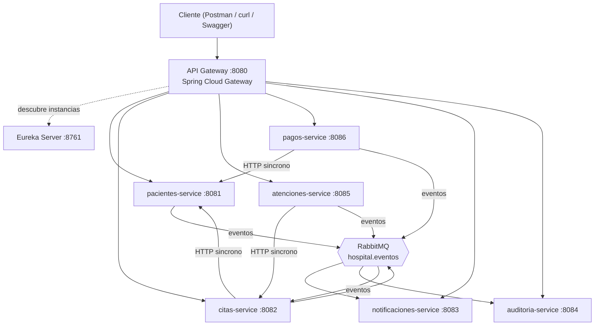

# Hospital Vida Salud — Microservicios (Evaluación T2)

Plataforma administrativa hospitalaria **académica** basada en microservicios, desarrollada para la
segunda evaluación (T2) del curso *Desarrollo de Aplicaciones Web II* (CIBERTEC, 2026).

> Todos los datos son ficticios. El sistema no diagnostica ni recomienda tratamientos.


## Arquitectura



| Componente | Puerto | Descripción |
|---|---|---|
| `eureka-server` | 8761 | Registro y descubrimiento de servicios |
| `api-gateway` | 8080 | Punto de entrada único (rutas `lb://` por nombre de servicio) |
| `pacientes-service` | 8081 | Registro de pacientes, duplicados por documento, estado |
| `citas-service` | 8082 | Agenda, máquina de estados de la cita, llamada síncrona a Pacientes |
| `notificaciones-service` | 8083 | Consume eventos y genera notificaciones simuladas |
| `auditoria-service` | 8084 | Consume todos los eventos; trazabilidad inmutable |
| `atenciones-service` | 8085 | Atención administrativa de una cita confirmada |
| `pagos-service` | 8086 | Pagos simulados, número de operación único, idempotencia |
| `hospital-commons` | — | Librería técnica (errores, RabbitMQ reactivo, resiliencia, paginación) |

**Tecnologías:** Java 21, Spring Boot 3.5, Spring Cloud 2025.0 (Gateway, Eureka), Spring WebFlux (`Mono`/`Flux`),
Spring Data R2DBC + PostgreSQL 16, RabbitMQ 3.13 (`reactor-rabbitmq`), OpenTelemetry (Jaeger y Seq),
Testcontainers, Maven Wrapper, GitHub Actions.

La documentación completa de diseño está en [`docs/documento-tecnico.md`](docs/documento-tecnico.md)
las especificaciones por servicio en [`docs/specs/`](docs/specs/), la guía de sustentación en
[`docs/guia-sustentacion.md`](docs/guia-sustentacion.md) y las evidencias en [`docs/evidencias/`](docs/evidencias/).

## Requisitos

* JDK 21
* Docker y Docker Compose v2 (infraestructura y pruebas de integración con Testcontainers)
* `curl`, `openssl` (scripts)

## Ejecutar la solución

```bash
# 1. Infraestructura: PostgreSQL, RabbitMQ, Jaeger y Seq
scripts/preparar-entorno.sh              # crea infra/.env con contraseñas aleatorias (no versionado)
docker compose -f infra/docker-compose.yml up -d

# 2. Compilar y empaquetar
./mvnw -DskipTests package

# 3. Agente OpenTelemetry (trazas y logs) y arranque de todos los servicios
scripts/descargar-otel-agent.sh
scripts/iniciar-todo.sh                  # Eureka -> Gateway -> servicios (logs en logs/)
                                         # (o solo algunos: scripts/iniciar-todo.sh eureka-server api-gateway pacientes-service)

# Detener
scripts/detener-todo.sh
docker compose -f infra/docker-compose.yml down        # añadir -v para borrar los datos
```

### Alternativa: todo en contenedores (un solo comando)

```bash
scripts/preparar-entorno.sh
docker compose -f infra/docker-compose.yml --profile apps up -d --build
# detener: docker compose -f infra/docker-compose.yml --profile apps down
```

El perfil `apps` construye una imagen por servicio a partir del `Dockerfile` de la raíz (multi-etapa, argumento
`MODULE`, usuario sin privilegios, agente OpenTelemetry con hash verificado y *healthcheck*) y los arranca en el orden
correcto (Eureka → resto). Los puertos son los mismos; **detenga antes los procesos del host**
(`scripts/detener-todo.sh`). Sin el perfil, `docker compose up` levanta solo la infraestructura.

| Panel | URL |
|---|---|
| Eureka (servicios registrados) | http://localhost:8761 |
| RabbitMQ (exchange `hospital.eventos`, colas) | http://localhost:15672 (usuario/clave en `infra/.env`) |
| Jaeger (trazas) | http://localhost:16686 |
| Seq (logs) | http://localhost:8090 (usuario `admin`, clave inicial `SEQ_ADMIN_PASSWORD` de `infra/.env`; Seq pide cambiarla en el primer acceso) |
| Swagger de cada servicio | `http://localhost:808x/swagger-ui.html` |
| Rutas del Gateway | http://localhost:8080/actuator/gateway/routes |

> Para demostrar el sistema fuera del horario de atención (por defecto lunes a sábado, 08:00–17:30),
> arranque `citas-service` con `AGENDA_DIAS_ATENCION`, `AGENDA_HORA_INICIO` y `AGENDA_HORA_ULTIMO_INICIO`.

## Probar

```bash
# Pruebas unitarias y de integración (Testcontainers levanta PostgreSQL y RabbitMQ solos)
./mvnw --batch-mode verify
```

* **Postman:** importar `docs/postman/hospital-vida-salud.postman_collection.json` y el entorno
  `hospital-vida-salud.postman_environment.json` (`baseUrl = http://localhost:8080`); ejecutar las carpetas en orden.
* **curl:** ver [`docs/ejemplos-curl.md`](docs/ejemplos-curl.md).

## Integración continua

`.github/workflows/ci.yml` compila y prueba todos los módulos (`./mvnw verify`) en cada *push* y *pull request*
a `main`. Si la compilación o una prueba falla, el job queda en rojo y el cambio no debe integrarse.

## Seguridad y datos

* Sin credenciales en el repositorio: las contraseñas se generan en `infra/.env` (ignorado por git).
* Datos de prueba ficticios; los logs no incluyen datos personales.
