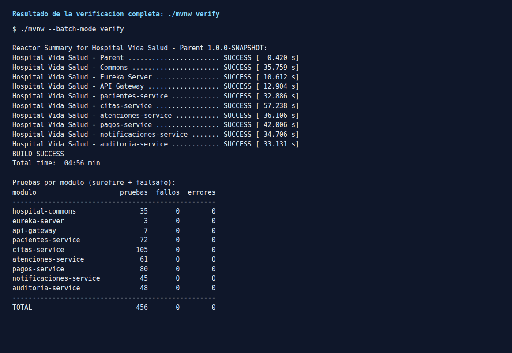
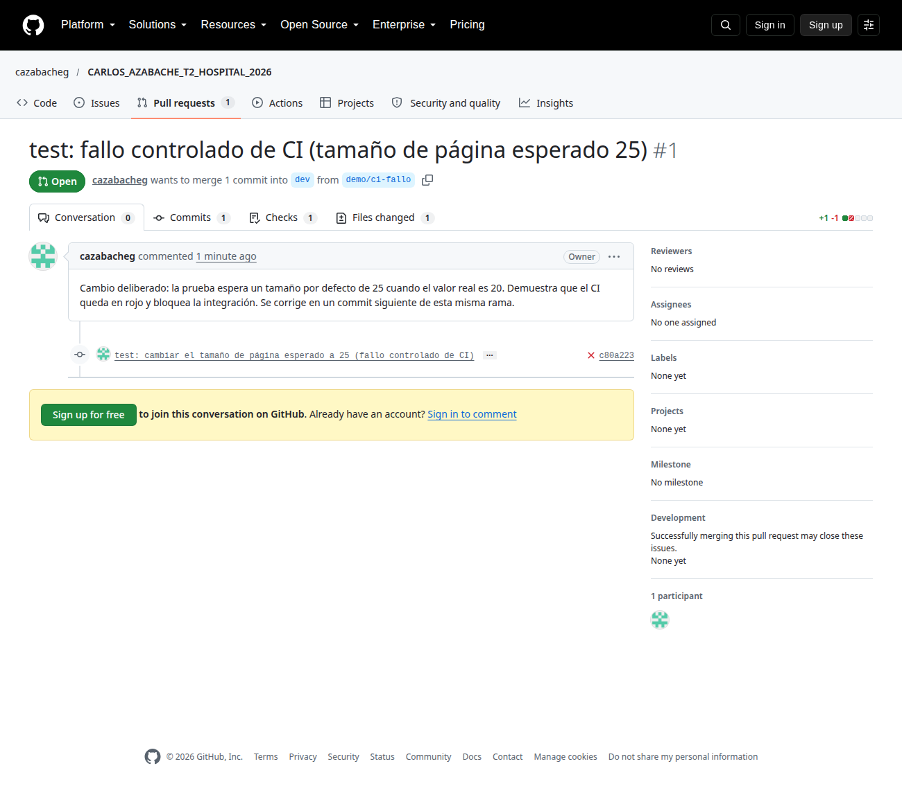
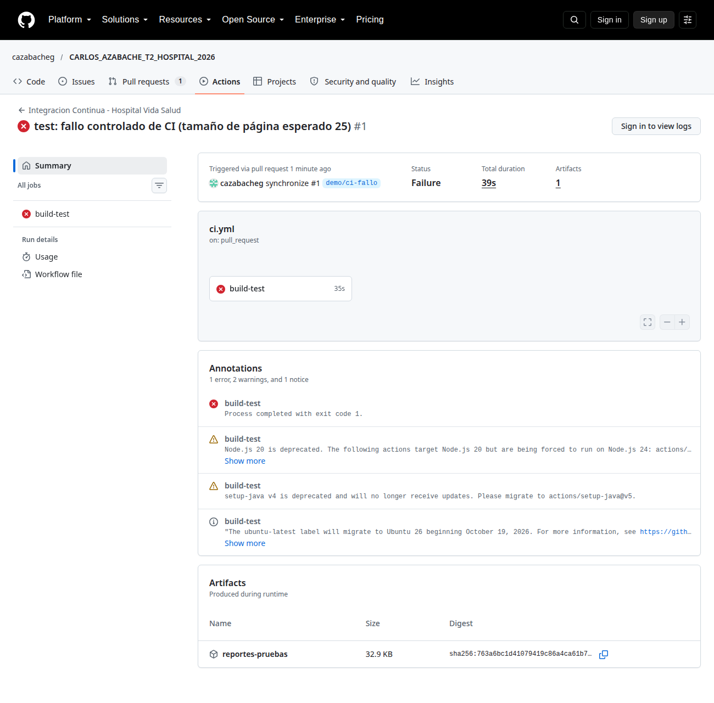
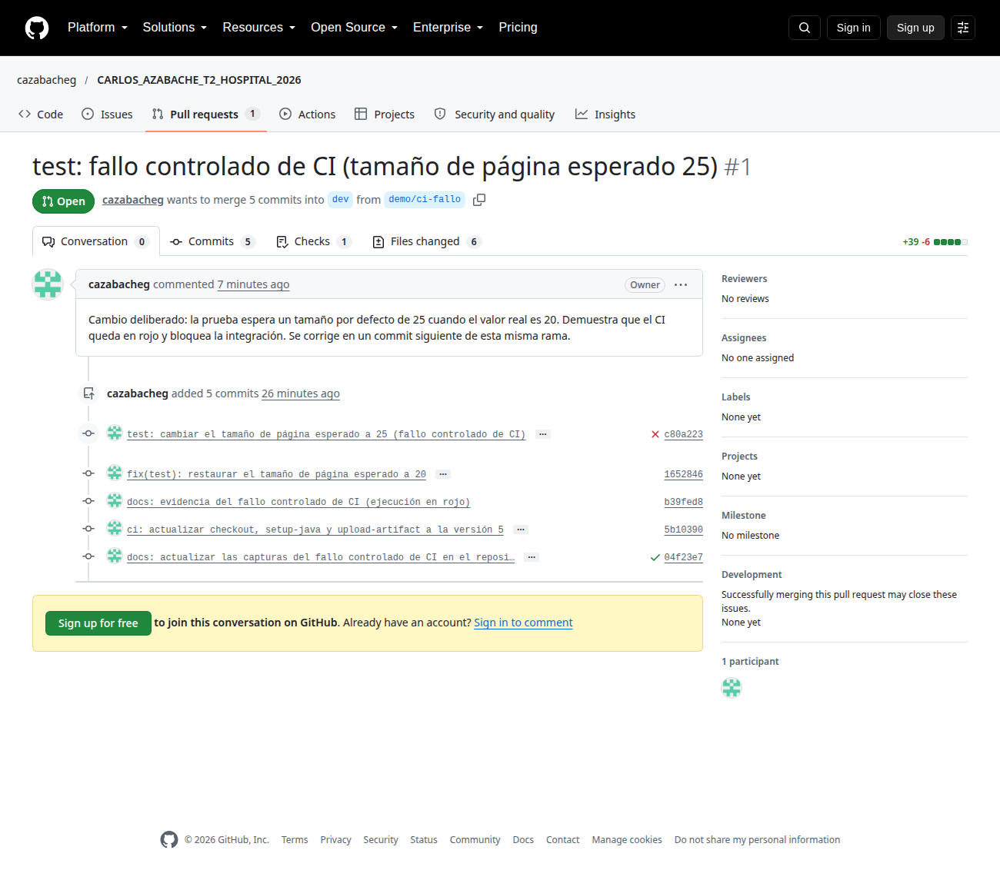
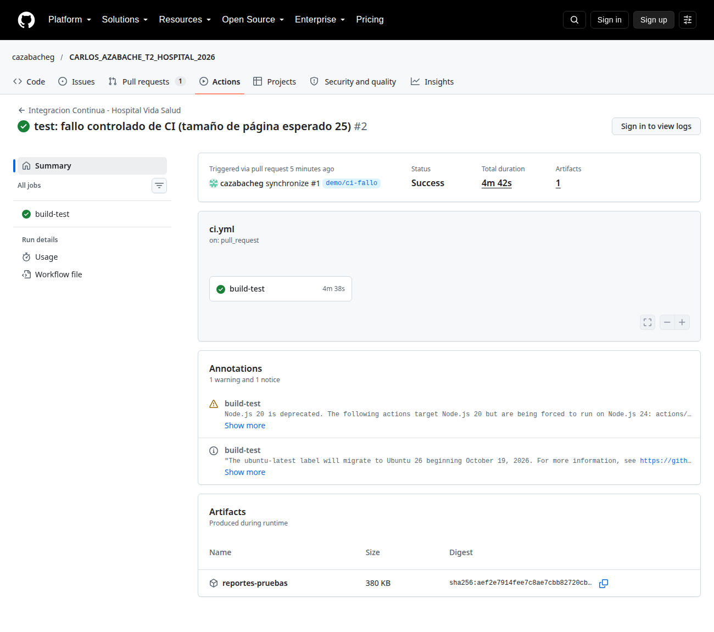
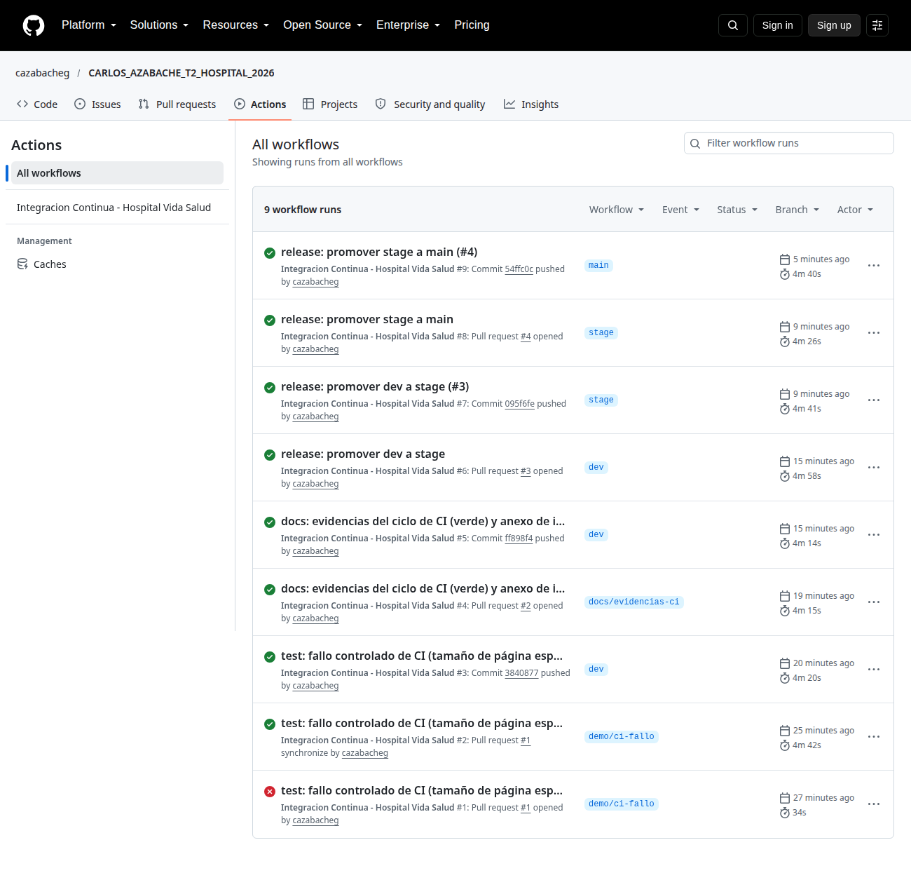
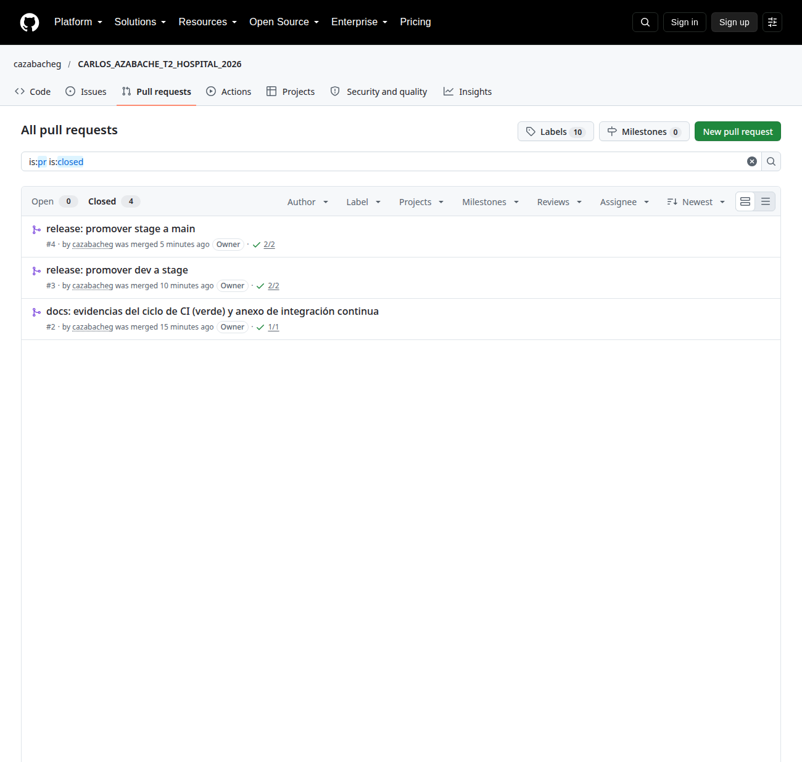
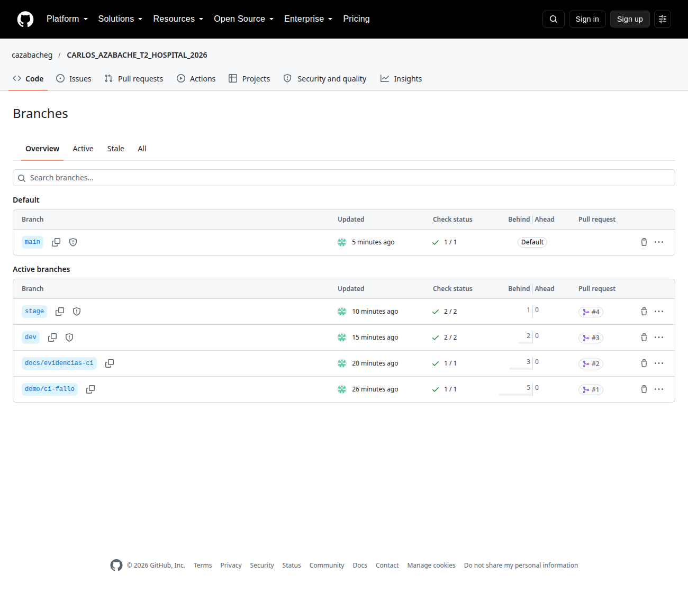

Capturas y salidas del sistema en ejecución que respaldan el documento técnico: servicios registrados, enrutamiento, flujo funcional, persistencia, mensajería, trazabilidad, pruebas funcionales obligatorias y ciclo de integración continua.

# 1. Eureka: las 7 instancias registradas


# 2. API Gateway: rutas `lb://` hacia los servicios


# 3. Salud del servicio de citas (base de datos, RabbitMQ y Eureka)


# 4. Flujo funcional completo por el Gateway (Newman: 49 peticiones, 86 aserciones, 0 fallos)


# 5. Pruebas funcionales obligatorias del enunciado (§28)

Ejecución sobre el sistema **levantado desde cero** con `scripts/levantar-docker.sh` a partir del zip del código fuente (sin imágenes, sin caché y sin datos previos; 4 minutos), con la colección de Postman ejecutada por Newman a través del API Gateway: **49 peticiones, 86 aserciones, 0 fallos**.

## 5.1 Las 10 pruebas obligatorias

| # | Prueba obligatoria (§28) | Petición ejecutada | Resultado obtenido |
|---|---|---|---|
| 1 | Registrar un paciente | `POST /api/pacientes` | 201 `estado ACTIVO` Created |
| 2 | Consultar un paciente por identificador | `GET /api/pacientes/{id}` | 200 `estado ACTIVO` |
| 3 | Registrar un paciente duplicado y demostrar el rechazo | `POST /api/pacientes` con el mismo documento | 409 `PACIENTE_DUPLICADO` |
| 4 | Registrar una cita para un paciente válido | `POST /api/citas` | 201 `estado PENDIENTE` Created |
| 5 | Consultar y cambiar el estado de la cita con validaciones | `GET /api/citas/{id}`; `PATCH …/estado` a CONFIRMADA; repetir la confirmación; confirmar una cita cancelada | consulta 200 `estado PENDIENTE`; confirmar 200 `estado CONFIRMADA`; repetir 409 `TRANSICION_NO_PERMITIDA`; cancelada 409 `TRANSICION_NO_PERMITIDA` |
| 6 | Comunicación síncrona entre microservicios | `POST /api/citas` (Citas consulta a Pacientes por HTTP, vía Eureka); paciente inexistente; paciente inactivo | válido 201 `estado PENDIENTE`; inexistente 404 `PACIENTE_NO_ENCONTRADO`; inactivo 422 `PACIENTE_INACTIVO`; con Pacientes caído: 503 `SERVICIO_PACIENTES_NO_DISPONIBLE` (sección Jaeger) |
| 7 | Publicar y consumir un evento RabbitMQ | `PATCH …/estado` CONFIRMADA publica `cita.confirmada`; luego `GET /api/notificaciones` y `GET /api/auditoria/recursos/CITA/{id}/historial` | confirmar 200 `estado CONFIRMADA`; el evento llegó a Notificaciones (11 avisos del paciente) y a Auditoría (4 eventos de la cita); ver secciones de Jaeger y RabbitMQ |
| 8 | Demostrar persistencia SQL mediante R2DBC | Consultas SQL en las trazas y tablas de PostgreSQL | Ver secciones de Jaeger (spans SQL) y de PostgreSQL |
| 9 | Ejecutar las pruebas automatizadas localmente | `./mvnw verify` | BUILD SUCCESS en los 9 módulos (ver 5.4) |
| 10 | Push o pull request y resultado de GitHub Actions | Pull requests hacia `dev`, `stage` y `main` | CI en rojo (fallo controlado) y luego en verde; ver sección de Integración continua |

## 5.2 Detalle de las 49 peticiones de la ejecución

Todas las aserciones de cada petición pasaron. «Resultado» muestra el código de negocio del error o el estado del recurso devuelto.

| # | Carpeta | Petición | HTTP | Resultado |
|---|---|---|---|---|
| 1 | Pacientes | Registrar paciente (valido) | 201 | `ACTIVO` |
| 2 | Pacientes | Consultar paciente por id | 200 | `ACTIVO` |
| 3 | Pacientes | Registrar paciente DUPLICADO (rechazo 409) | 409 | `PACIENTE_DUPLICADO` |
| 4 | Pacientes | Registrar paciente con datos invalidos (400) | 400 | `VALIDACION_FALLIDA` |
| 5 | Pacientes | Consultar paciente inexistente (404) | 404 | `PACIENTE_NO_ENCONTRADO` |
| 6 | Pacientes | Listar pacientes (paginado) | 200 |  |
| 7 | Pacientes | Actualizar datos de contacto | 200 | `ACTIVO` |
| 8 | Pacientes | Registrar segundo paciente (para el caso inactivo) | 201 | `ACTIVO` |
| 9 | Pacientes | Inactivar segundo paciente | 200 | `INACTIVO` |
| 10 | Pacientes | Inactivar de nuevo (409 transicion no permitida) | 409 | `TRANSICION_NO_PERMITIDA` |
| 11 | Citas | Registrar cita (paciente valido) -> PENDIENTE | 201 | `PENDIENTE` |
| 12 | Citas | Consultar cita | 200 | `PENDIENTE` |
| 13 | Citas | Choque de agenda: mismo profesional y hora (409) | 409 | `CITA_CHOQUE_AGENDA` |
| 14 | Citas | Cita para paciente inexistente (404) | 404 | `PACIENTE_NO_ENCONTRADO` |
| 15 | Citas | Cita para paciente INACTIVO (422) | 422 | `PACIENTE_INACTIVO` |
| 16 | Citas | Cita en horario invalido (400) | 400 | `HORARIO_FUERA_DE_AGENDA` |
| 17 | Citas | Listar citas del paciente | 200 |  |
| 18 | Citas | Confirmar cita -> evento cita.confirmada | 200 | `CONFIRMADA` |
| 19 | Citas | Transicion no permitida: confirmar de nuevo (409) | 409 | `TRANSICION_NO_PERMITIDA` |
| 20 | Citas | ATENDIDA no se pone por PATCH (409) | 409 | `TRANSICION_NO_PERMITIDA` |
| 21 | Citas | Reprogramar cita -> vuelve a PENDIENTE | 200 | `PENDIENTE` |
| 22 | Citas | Cancelar cita (mas de 24 h de anticipacion) | 200 | `CANCELADA` |
| 23 | Citas | Confirmar una cita CANCELADA (409, RN-05) | 409 | `TRANSICION_NO_PERMITIDA` |
| 24 | Citas | Cita inexistente (404) | 404 | `CITA_NO_ENCONTRADA` |
| 25 | Atenciones | Crear cita proxima (empieza en <= 30 min) | 201 | `PENDIENTE` |
| 26 | Atenciones | Atencion sobre cita PENDIENTE (409 CITA_NO_CONFIRMADA) | 409 | `CITA_NO_CONFIRMADA` |
| 27 | Atenciones | Confirmar la cita proxima | 200 | `CONFIRMADA` |
| 28 | Atenciones | Atencion fuera de ventana: cita lejana (409) | 409 | `CITA_NO_CONFIRMADA` |
| 29 | Atenciones | Registrar atencion -> evento atencion.registrada | 201 | `REGISTRADA` |
| 30 | Atenciones | Atencion duplicada (409) | 409 | `CITA_NO_CONFIRMADA` |
| 31 | Atenciones | La cita paso a ATENDIDA (consistencia eventual) | 200 | `ATENDIDA` |
| 32 | Atenciones | Consultar atencion | 200 | `REGISTRADA` |
| 33 | Atenciones | Listar atenciones del paciente | 200 |  |
| 34 | Atenciones | Anular atencion (cita aun no ocurrida -> cita CANCELADA) | 200 | `ANULADA` |
| 35 | Pagos | Registrar pago (monto valido) | 201 | `REGISTRADO` |
| 36 | Pagos | REINTENTO con la misma Idempotency-Key (mismo pago, sin duplicar) | 201 | `REGISTRADO` |
| 37 | Pagos | Misma clave con OTRO monto (422) | 422 | `CLAVE_IDEMPOTENCIA_REUTILIZADA` |
| 38 | Pagos | Sin cabecera Idempotency-Key (400) | 400 | `CLAVE_IDEMPOTENCIA_REQUERIDA` |
| 39 | Pagos | Monto 0 (400 MONTO_INVALIDO) | 400 | `MONTO_INVALIDO` |
| 40 | Pagos | Monto negativo (400 MONTO_INVALIDO) | 400 | `MONTO_INVALIDO` |
| 41 | Pagos | Pago para paciente inexistente (404) | 404 | `PACIENTE_NO_ENCONTRADO` |
| 42 | Pagos | Consultar pago | 200 | `REGISTRADO` |
| 43 | Pagos | Listar pagos del paciente | 200 |  |
| 44 | Pagos | Anular pago | 200 | `ANULADO` |
| 45 | Pagos | Anular de nuevo (409 PAGO_YA_ANULADO) | 409 | `PAGO_YA_ANULADO` |
| 46 | Notificaciones y Auditoria | Notificaciones del paciente (RabbitMQ -> Notificaciones) | 200 |  |
| 47 | Notificaciones y Auditoria | Historial de auditoria de la cita (estados y origen) | 200 |  |
| 48 | Notificaciones y Auditoria | Historial de auditoria del paciente | 200 |  |
| 49 | Notificaciones y Auditoria | Auditoria filtrada por tipo de evento | 200 |  |

## 5.3 Respuestas reales de los casos clave

**Paciente duplicado**, `POST /api/pacientes`

```text
HTTP 409
{
  "type": "about:blank",
  "title": "Conflicto",
  "status": 409,
  "detail": "Ya existe un paciente con el documento DNI 96477501.",
  "instance": "/api/pacientes",
  "codigo": "PACIENTE_DUPLICADO",
  "timestamp": "2026-10-11T16:19:32.340989426-05:00"
}
```

**Transición de estado no permitida**, `PATCH /api/citas/140e0416-a69b-4d65-bdd7-3b8def1d5e64/estado`

```text
HTTP 409
{
  "type": "about:blank",
  "title": "Conflicto",
  "status": 409,
  "detail": "No se puede pasar una cita de CONFIRMADA a CONFIRMADA.",
  "instance": "/api/citas/140e0416-a69b-4d65-bdd7-3b8def1d5e64/estado",
  "codigo": "TRANSICION_NO_PERMITIDA",
  "timestamp": "2026-10-11T16:19:36.561351420-05:00"
}
```

**Choque de agenda**, `POST /api/citas`

```text
HTTP 409
{
  "type": "about:blank",
  "title": "Conflicto",
  "status": 409,
  "detail": "El profesional MED-255 ya tiene una cita en ese horario.",
  "instance": "/api/citas",
  "codigo": "CITA_CHOQUE_AGENDA",
  "timestamp": "2026-10-11T16:19:35.318684620-05:00"
}
```

**Monto de pago inválido**, `POST /api/pagos`

```text
HTTP 400
{
  "type": "about:blank",
  "title": "Solicitud invalida",
  "status": 400,
  "detail": "El monto debe ser mayor que cero.",
  "instance": "/api/pagos",
  "codigo": "MONTO_INVALIDO",
  "timestamp": "2026-10-11T16:19:43.895390534-05:00"
}
```

**Reintento idempotente de un pago (mismo pago, sin duplicar)**, `POST /api/pagos`

```text
HTTP 201
Idempotent-Replayed: true
{
  "id": "9f110d4e-3cca-4a02-89c9-95c4e0d4a298",
  "numeroOperacion": "OP-20261011-000001",
  "pacienteId": "c4de1ca5-3a41-417d-8e24-57cd82bec3eb",
  "citaId": "140e0416-a69b-4d65-bdd7-3b8def1d5e64",
  "concepto": "Reserva de cita - Medicina General",
  "monto": 80.0,
  "moneda": "PEN",
  "fechaPago": "2026-10-11T16:19:42.918996-05:00",
  "medioPago": "TARJETA",
  "estado": "REGISTRADO",
  "motivoAnulacion": null,
  "fechaActualizacion": "2026-10-11T16:19:42.918996-05:00"
}
```

**La cita pasa a ATENDIDA por el evento de la atención**, `GET /api/citas/d3d205ad-947e-465b-a4c8-1ba43226b9a7`

```text
HTTP 200
{
  "id": "d3d205ad-947e-465b-a4c8-1ba43226b9a7",
  "codigo": "CIT-20261011-000002",
  "pacienteId": "c4de1ca5-3a41-417d-8e24-57cd82bec3eb",
  "especialidad": "CARDIOLOGIA",
  "especialidadNombre": "Cardiología",
  "fechaHora": "2026-10-11T16:30:00-05:00",
  "profesionalCodigo": "MED-664",
  "motivo": null,
  "estado": "ATENDIDA",
  "fechaCreacion": "2026-10-11T16:19:37.750616-05:00",
  "fechaActualizacion": "2026-10-11T16:19:39.455614-05:00"
}
```

## 5.4 Pruebas automatizadas (`./mvnw verify`)




# 6. Documentación interactiva (Swagger UI)


# 7. Trazas distribuidas en Jaeger

Crear una cita: Gateway → Citas → Pacientes (llamada síncrona) con las consultas SQL de R2DBC.


Confirmar una cita: la traza continúa por RabbitMQ hasta los consumidores de Notificaciones y Auditoría.


Con Pacientes caído: el servicio de citas responde `503` y la traza muestra el *span* fallido.


# 8. Logs centralizados en Seq, filtrados por `TraceId`


# 9. RabbitMQ: exchange `hospital.eventos` y colas


# 10. Persistencia SQL con R2DBC y trigger de inmutabilidad de la auditoría


# 11. Integración continua con GitHub Actions y políticas de rama

Repositorio: <https://github.com/cazabacheg/CARLOS_AZABACHE_T2_HOSPITAL_2026>. Las ramas `dev`, `stage` y `main` solo aceptan cambios por *pull request* con el check `build-test` en verde. Un *push* directo a `main` es rechazado:

```text
$ git push origin fix/test-secuencia-secuencial:main   # intento de push directo a main
remote: error: GH006: Protected branch update failed for refs/heads/main.        
remote: 
remote: - Changes must be made through a pull request.        
remote: 
remote: - Required status check "build-test" is expected.        
To https://github.com/cazabacheg/CARLOS_AZABACHE_T2_HOSPITAL_2026.git
 ! [remote rejected] fix/test-secuencia-secuencial -> main (protected branch hook declined)
error: failed to push some refs to 'https://github.com/cazabacheg/CARLOS_AZABACHE_T2_HOSPITAL_2026.git'
```

Fallo controlado: se cambia a propósito el valor esperado de una prueba en la rama `demo/ci-fallo` y se abre el *pull request* hacia `dev`. El pipeline queda **en rojo** y el *merge* queda bloqueado.





Corrección: se restaura la prueba en la misma rama; el pipeline vuelve a **verde** y el *merge* se habilita.





Historial de ejecuciones y ramas protegidas (escudo junto a `main`, `stage` y `dev`): una ejecución en rojo (el fallo controlado) y las demás en verde, incluidas las promociones `dev` → `stage` → `main` por *pull request*.






