# 1. Descripción del problema y alcance

## 1.1 Situación actual

El Hospital Vida Salud opera una aplicación **monolítica** que concentra registro de pacientes, citas, atenciones, laboratorio, hospitalización, farmacia, facturación, notificaciones y reportes. Los síntomas descritos en el caso son:

| Síntoma | Causa arquitectónica |
|---|---|
| Demoras al registrar y consultar citas en horas pico | Todos los módulos comparten proceso y base de datos; no se puede escalar solo "citas". |
| Dificultad para modificar un módulo sin afectar a otros | Alto acoplamiento: código y esquema compartidos. |
| Duplicación de información | Cada módulo replica datos del paciente. |
| Retrasos en la comunicación entre áreas | Notificaciones y reportes dependen de procesos síncronos y consultas cruzadas. |
| Despliegues riesgosos | Una sola unidad de despliegue: un fallo menor obliga a redesplegar todo y puede tumbar todo. |

## 1.2 Objetivo

Diseñar e implementar una plataforma administrativa **distribuida** basada en microservicios, con responsabilidades delimitadas, evolución independiente, comunicación síncrona y asíncrona, persistencia reactiva e integración continua automatizada.

## 1.3 Alcance de esta entrega

El enunciado permite justificar la profundidad de cada servicio. Esta es la decisión de alcance:

| Componente | Estado | Profundidad |
|---|---|---|
| Eureka Server | Implementado | Completo |
| API Gateway | Implementado | Completo (rutas por nombre de servicio) |
| **Pacientes** | Implementado | Completo (CRUD, duplicados, estados, eventos) |
| **Citas** | Implementado | Completo (agenda, máquina de estados, llamada síncrona a Pacientes, eventos) |
| **Atenciones** | Implementado | Registro administrativo de la atención vinculada a una cita confirmada |
| **Pagos** | Implementado | Pagos simulados con validación de monto y de número de operación único |
| **Notificaciones** | Implementado | Consumidor de eventos, persiste notificaciones simuladas. Eventos de cita y paciente: prioridad normal. Eventos de atención y pago: **prioridad baja, al final** |
| **Auditoría** | Implementado | Consumidor de eventos, persiste trazabilidad |
| Observabilidad (no exigida por el enunciado) | Implementado | Trazas distribuidas en Jaeger y logs centralizados en Seq con OpenTelemetry (§7.4) |
| Laboratorio, Hospitalización, Farmacia | Diseño referencial (§5.8) | No implementados; el modelo de eventos los admite sin cambios |

**Justificación.** El enunciado exige "un flujo funcional de extremo a extremo" y declara que no es obligatorio implementar todos los servicios con la misma profundidad (§16). Se implementan seis servicios de negocio y de soporte más Eureka y Gateway, cubriendo el flujo completo del §27 (paciente → cita → confirmación → evento → atención) y la regla de pagos del §24; Laboratorio es opcional en el propio enunciado. El enunciado advierte que no se evaluará favorablemente una división artificial (§26, Actividad 6): cada servicio tiene un dueño de datos y reglas propias.

**Restricción de uso.** El sistema es académico. No diagnostica ni recomienda tratamientos. Todos los datos son ficticios.

# 2. Análisis del negocio

## 2.1 Actores y roles

| Actor | Interacción en la solución |
|---|---|
| Paciente | Solicita o consulta citas; recibe avisos (notificaciones simuladas). |
| Personal de admisión | Registra pacientes; programa, reprograma, confirma y cancela citas. |
| Personal de salud | Consulta información administrativa de pacientes y citas; registra la atención de una cita confirmada (lo que la deja `ATENDIDA`) y marca citas como ausentes. |
| Caja/administración | Registra pagos simulados y los anula. |
| Laboratorio, Farmacia | Fuera de la implementación; sus procesos se describen en §5.8. |
| Administrador del sistema | Supervisa servicios (panel Eureka, panel RabbitMQ, `/actuator/health`). |
| Equipo de desarrollo | Mantiene el código y el flujo de CI. |

> La entrega no implementa autenticación. Se documenta como mejora (§14): validación de token en el Gateway.

## 2.2 Procesos del negocio implementados

1. **Registro de paciente** (Proceso 1).
2. **Programación de citas** (Proceso 2): crear, consultar, reprogramar, cambiar estado.
3. **Atención** simulada vinculada a una cita (Proceso 3).
4. **Pagos** simulados (Proceso 7, versión reducida: pago con concepto, sin cargos separados).
5. **Notificación** de eventos (Proceso 8).
6. **Trazabilidad** de cambios de estado (Sección 14 del enunciado).

## 2.3 Reglas de negocio

| ID | Regla | Servicio responsable |
|---|---|---|
| RN-01 | No pueden existir dos pacientes con el mismo (`tipo_documento`, `numero_documento`). | Pacientes |
| RN-02 | Un paciente tiene estado `ACTIVO` o `INACTIVO`. Solo un paciente `ACTIVO` puede recibir citas nuevas. | Pacientes (dueño del dato) / Citas (la consulta) |
| RN-03 | Una cita se asocia a paciente, especialidad, fecha-hora y estado válido. | Citas |
| RN-04 | Estados de cita: `PENDIENTE`, `CONFIRMADA`, `ATENDIDA`, `CANCELADA`, `AUSENTE`; solo se permiten las transiciones de §6.3. | Citas |
| RN-05 | No se puede confirmar una cita `CANCELADA`. No se puede marcar `ATENDIDA` una cita que no esté `CONFIRMADA`, y solo se llega a `ATENDIDA` registrando una atención (no por cambio de estado directo). | Citas |
| RN-06 | **Agenda simplificada** (supuestos A-01…A-04, §2.4): un profesional no puede tener dos citas activas en el mismo horario; un paciente tampoco. | Citas |
| RN-07 | La fecha-hora de una cita nueva o reprogramada debe ser futura y caer dentro del horario de atención. | Citas |
| RN-08 | Todo cambio importante de estado se registra (fecha, recurso, estado anterior, estado nuevo, origen) y publica un evento asíncrono. | Citas, Pacientes → Auditoría |
| RN-09 | Los pagos no admiten monto ≤ 0 ni número de operación duplicado. Guardan fecha, monto, medio y número de operación de prueba. | Pagos |
| RN-10 | Una cama ocupada no puede asignarse a otro ingreso activo. | Hospitalización (diseño, §5.8) |
| RN-11 | Una atención solo puede registrarse sobre una cita **CONFIRMADA**; una cita tiene como máximo una atención no anulada. | Atenciones |
| RN-12 | Al registrarse una atención, la cita pasa a `ATENDIDA` (consistencia eventual por evento). | Citas (reacciona al evento) |
| RN-13 | Un pago se asocia a un paciente existente y activo. | Pagos |
| RN-14 | Dos cambios simultáneos sobre la misma cita no pueden pisarse: el segundo se rechaza (bloqueo optimista). | Citas |
| RN-15 | Una cita solo se puede **cancelar o reprogramar hasta 24 horas antes** de su inicio. Después se da por efectuada: solo puede terminar `ATENDIDA` o `AUSENTE`. | Citas |
| RN-16 | La atención solo se registra **desde 30 minutos antes** del inicio de la cita en adelante. | Atenciones |
| RN-17 | Si se anula una atención y la cita **aún no ocurrió**, la cita pasa a `CANCELADA`; si ya ocurrió, sigue `ATENDIDA` y la anulación queda como corrección administrativa. `CANCELADA` es final: para reagendar se crea una cita nueva. | Citas (reacciona al evento) |

## 2.4 Supuestos de la agenda simplificada

El enunciado permite modelar una agenda simplificada si se documentan los supuestos:

* **A-01.** Horario de atención: lunes a sábado, de 08:00 a 17:30 (último inicio de cita).
* **A-02.** Las citas se programan en bloques de **30 minutos**; la hora debe estar en minuto `00` o `30`.
* **A-03.** El "profesional" se identifica por un `profesional_codigo` ficticio (p. ej. `MED-001`). No existe catálogo de profesionales.
* **A-04.** Se consideran "citas activas" las que están en `PENDIENTE` o `CONFIRMADA`. Las canceladas liberan el horario.
* **A-05.** No se modelan feriados, vacaciones ni duración variable.
* **A-06.** La zona horaria única es `America/Lima`.
* **A-07.** Las citas se programan con un máximo de **90 días** de anticipación.
* **A-08.** La especialidad se elige de un **catálogo cerrado**: Medicina General, Pediatría, Cardiología, Ginecología, Traumatología, Dermatología, Oftalmología (códigos `MEDICINA_GENERAL`, `PEDIATRIA`, …).
* **A-09.** No se valida la hora para marcar `AUSENTE` o `CONFIRMADA` (simplificación para poder demostrarlo con citas futuras).
* **A-10.** Los parámetros de agenda (días y horario de atención, bloque, anticipación máxima, plazo de cambio de 24 h, ventana de atención de 30 min) son **configurables** por propiedades/variables de entorno. Los valores de arriba son los predeterminados; permite, por ejemplo, demostrar el sistema un domingo sin cambiar código.

**Por qué RN-15 y RN-16 juntas.** Las ventanas "cancelar hasta 24 h antes" y "atender desde 30 min antes" no se superponen. Así se **elimina por regla de negocio** la carrera "se cancela la cita mientras se registra su atención", que de otro modo exigiría una saga con compensación entre servicios.

## 2.5 Estados y transiciones — vista de negocio

Cada proceso usa estados explícitos y valida transiciones (enunciado §14). El detalle de Citas está en §6.3; Pacientes solo alterna `ACTIVO` ↔ `INACTIVO`; Atenciones y Pagos en §5.5 y §5.6.

# 3. Identificación de microservicios

## 3.1 Criterio de partición

Los límites siguen **capacidades de negocio** (Bounded Contexts), no capas técnicas:

* *Pacientes* es la **fuente de verdad de identidad**. Cambia por razones distintas (cumplimiento, datos demográficos) que las citas.
* *Citas* tiene su propio ciclo de vida, reglas de agenda y volumen (el más escalable en horas pico).
* *Notificaciones* y *Auditoría* son **consumidores puros de eventos**: no participan en la respuesta al usuario y no deben ralentizar ni tumbar el flujo principal si fallan.

Se evitó deliberadamente crear servicios por tabla o por capa (p. ej. un "servicio de DTOs" o "servicio de validaciones").

## 3.2 Catálogo de servicios

| Servicio | Puerto | Responsabilidad | Base de datos | Publica | Consume | Llama (síncrono) |
|---|---|---|---|---|---|---|
| `eureka-server` | 8761 | Registro y descubrimiento | — | — | — | — |
| `api-gateway` | 8080 | Punto de entrada único, enrutamiento | — | — | — | Todos (vía Eureka) |
| `pacientes-service` | 8081 | Alta, consulta, actualización y estado de pacientes; detección de duplicados | `pacientes_db` | `paciente.registrado`, `paciente.estado-cambiado` | — | — |
| `citas-service` | 8082 | Programación, reprogramación, estados de citas; reglas de agenda | `citas_db` | `cita.creada`, `cita.confirmada`, `cita.reprogramada`, `cita.cancelada`, `cita.atendida`, `cita.ausente` | `atencion.registrada`, `atencion.anulada` | `pacientes-service` |
| `notificaciones-service` | 8083 | Genera y guarda notificaciones simuladas | `notificaciones_db` | — | `paciente.registrado`, `cita.*`; (baja prioridad) `atencion.registrada`, `pago.*` | — |
| `auditoria-service` | 8084 | Registra trazabilidad de cambios de estado | `auditoria_db` | — | `#` (todos) | — |
| `atenciones-service` | 8085 | Registro administrativo de la atención vinculada a una cita confirmada | `atenciones_db` | `atencion.registrada`, `atencion.finalizada`, `atencion.anulada` | — | `citas-service` |
| `pagos-service` | 8086 | Registro y anulación de pagos simulados; validación de monto y operación única | `pagos_db` | `pago.registrado`, `pago.anulado` | — | `pacientes-service` |

## 3.3 Propiedad de los datos

| Dato | Dueño (único que escribe) | Quién lo ve y cómo |
|---|---|---|
| Paciente | `pacientes-service` | Citas lo consulta por API (`GET /api/pacientes/{id}`); nunca lee su tabla. |
| Cita | `citas-service` | Notificaciones y Auditoría reciben copia del dato necesario **dentro del evento**. |
| Atención | `atenciones-service` | Citas se entera por el evento `atencion.registrada` (no lee la tabla). |
| Pago | `pagos-service` | Se consulta por su API. |
| Notificación | `notificaciones-service` | Se consulta por su API. |
| Evento de auditoría | `auditoria-service` | Se consulta por su API (solo lectura). |

**Regla de oro:** ningún servicio accede a las tablas de otro. No hay claves foráneas entre bases. `cita.paciente_id`, `atencion.cita_id` y `pago.paciente_id` son solo identificadores; su validez se verifica por contrato (§6.2).

## 3.4 Decisión sobre la base SQL

Se usa **una instancia PostgreSQL** con **una base de datos y un usuario por servicio** (`pacientes_db`/`pacientes_user`, etc.), levantada con Docker Compose. Es una compartición *física* solo por economía académica; lógicamente cada servicio solo tiene credenciales para su base, por lo que el aislamiento de datos se conserva. **Limitación documentada:** una caída de la instancia afectaría a todos los servicios; en producción cada servicio tendría su propia instancia o clúster.

# 4. Diseño de arquitectura

## 4.1 Diagrama de arquitectura

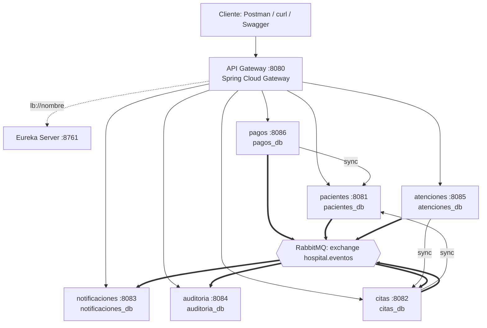

*Flechas finas `sync`: llamadas HTTP síncronas entre servicios. Flechas gruesas: eventos asíncronos por RabbitMQ (colas `notificaciones.cola`, `auditoria.cola` y `citas.atenciones.cola`). Todas las bases residen en una instancia PostgreSQL con acceso mediante R2DBC; cada servicio solo tiene credenciales para la suya. Todos los servicios se registran en Eureka y envían trazas y logs por OTLP a Jaeger y Seq (§7.4); por claridad no se dibujan esas flechas.*

## 4.2 Por qué los clientes no deben depender de los puertos internos

1. **Desacople de ubicación.** Con Eureka, las instancias aparecen, desaparecen y cambian de host/puerto (escalado, reinicios, contenedores). El cliente que conoce `:8082` se rompe; el que conoce solo `/api/citas` no.
2. **Un único punto de control.** Autenticación, límites de tasa, CORS, trazabilidad y registro de peticiones se aplican una sola vez en el Gateway.
3. **Seguridad.** Los servicios internos pueden quedar sin exponer a la red pública.
4. **Evolución independiente.** Se puede dividir, mover o versionar un servicio sin cambiar a los clientes.

## 4.3 Cómo se localiza una instancia (Eureka)

1. Al arrancar, cada servicio se **registra** en Eureka con su nombre lógico (`spring.application.name`), host y puerto, y envía **latidos** cada 30 s.
2. Eureka mantiene el registro y lo expone en `http://localhost:8761`.
3. El Gateway y los clientes `WebClient` **descargan y cachean** el registro. Una ruta `lb://citas-service` o una URL `http://pacientes-service/...` se resuelve contra ese registro; el **balanceador de carga del lado del cliente** (Spring Cloud LoadBalancer) elige una instancia (round-robin).
4. Si una instancia deja de enviar latidos, Eureka la expulsa tras un plazo y deja de recibir tráfico.

## 4.4 Diagrama de comunicación — flujo mínimo

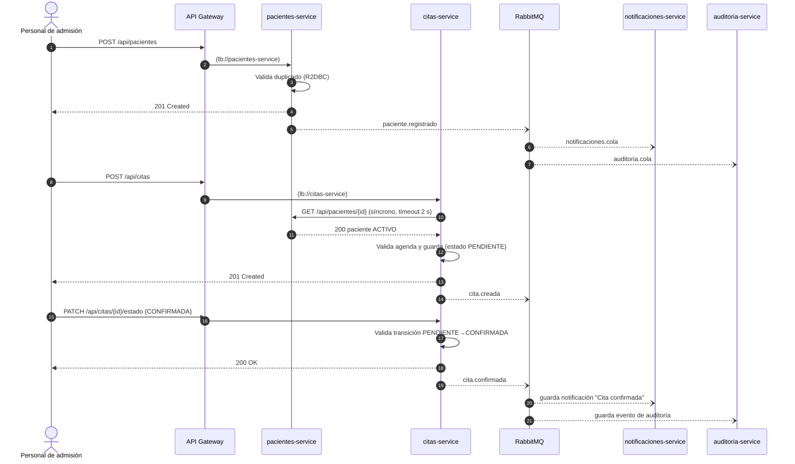

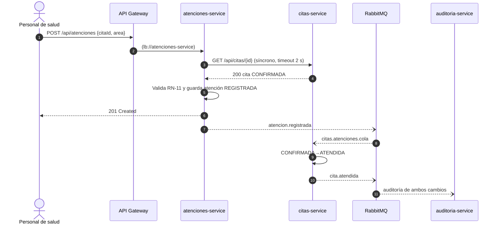

*Segundo flujo: la atención se registra de forma síncrona contra Citas, y el cambio de la cita a `ATENDIDA` ocurre de forma asíncrona (consistencia eventual).*

# 5. Especificación de los microservicios

## 5.1 `eureka-server`

* Aplicación Spring Boot con `@EnableEurekaServer`.
* No se registra a sí mismo (`register-with-eureka=false`, `fetch-registry=false`).
* Puerto 8761. Panel web con las instancias registradas = **evidencia obligatoria**.

## 5.2 `api-gateway`

* Spring Cloud Gateway (reactivo, sobre WebFlux/Netty), cliente Eureka.
* Rutas, todas con `lb://<nombre-servicio>`:

| Ruta externa | Destino |
|---|---|
| `/api/pacientes/**` | `lb://pacientes-service` |
| `/api/citas/**` | `lb://citas-service` |
| `/api/notificaciones/**` | `lb://notificaciones-service` |
| `/api/auditoria/**` | `lb://auditoria-service` |
| `/api/atenciones/**` | `lb://atenciones-service` |
| `/api/pagos/**` | `lb://pagos-service` |

* Las rutas se declaran **explícitamente** (no `discovery.locator` automático) para que el contrato externo sea estable y documentable.

## 5.3 `pacientes-service`

**Entidad `paciente`** (ver DDL en §8).

| Campo | Tipo | Restricción |
|---|---|---|
| `id` | UUID | PK |
| `tipo_documento` | texto | `DNI`, `CE`, `PASAPORTE`; obligatorio |
| `numero_documento` | texto | obligatorio; **único junto con tipo** |
| `nombres`, `apellidos` | texto | obligatorios |
| `fecha_nacimiento` | fecha | obligatoria, pasada |
| `telefono`, `correo` | texto | formato validado |
| `direccion` | texto | opcional |
| `fecha_registro` | timestamp | automática |
| `estado` | texto | `ACTIVO` (por defecto) / `INACTIVO` |

**Endpoints**

| Método y ruta | Resultado | Errores |
|---|---|---|
| `POST /api/pacientes` | `201` + paciente + `Location` | `400` validación, `409` documento duplicado |
| `GET /api/pacientes/{id}` | `200` paciente | `404` no existe |
| `GET /api/pacientes?estado=&numeroDocumento=` | `200` `Flux` de pacientes | — |
| `PUT /api/pacientes/{id}` | `200` paciente actualizado (el documento no se modifica) | `400`, `404` |
| `PATCH /api/pacientes/{id}/estado` | `200` | `400`, `404` |

Los listados (`GET` de colecciones) aceptan `pagina` y `tamano` y devuelven el total en la cabecera `X-Total-Count` (ver spec 00 §4.2).

**Decisiones de diseño:** el documento (tipo + número) es inmutable; no hay `DELETE` (la baja es lógica, `INACTIVO`); inactivar a un paciente impide nuevas citas y pagos pero no cancela las existentes.

**Eventos publicados:** `paciente.registrado`, `paciente.estado-cambiado`. Por privacidad, los eventos **no** llevan documento, nombres ni datos de contacto: solo identificadores y estados.

## 5.4 `citas-service`

**Entidad `cita`**: `id` (UUID), `codigo` (único, legible, formato `CIT-yyyyMMdd-NNNNNN`, p. ej. `CIT-20261012-000001`, generado con una secuencia), `paciente_id`, `especialidad` (código del catálogo A-08), `fecha_hora`, `profesional_codigo` (formato `AAA-999`, p. ej. `MED-001`), `motivo` (administrativo), `estado`, `fecha_creacion`, `fecha_actualizacion`, `version` (bloqueo optimista).

**Endpoints**

| Método y ruta | Resultado | Errores |
|---|---|---|
| `POST /api/citas` | `201` cita en `PENDIENTE` | `400` validación; `404`/`422` paciente inexistente o inactivo; `409` choque de agenda; `503`/`504` Pacientes no disponible |
| `GET /api/citas/{id}` | `200` | `404` |
| `GET /api/citas?pacienteId=&estado=&especialidad=&profesionalCodigo=&fecha=` | `200` `Flux` paginado | — |
| `PUT /api/citas/{id}/reprogramar` | `200`, estado vuelve a `PENDIENTE` | `400`, `404`, `409` choque, misma fecha, estado no permite reprogramar o modificación concurrente |
| `PATCH /api/citas/{id}/estado` `{ "estado": "CONFIRMADA", "motivo": "..." }` | `200`. Destinos admitidos: `CONFIRMADA`, `CANCELADA`, `AUSENTE` | `404`, `409` transición no permitida (incluye pedir `ATENDIDA` o `PENDIENTE`) o modificación concurrente |

Códigos de error de negocio devueltos en el cuerpo (ver §9.3): `PACIENTE_NO_ENCONTRADO`, `PACIENTE_INACTIVO`, `CITA_CHOQUE_AGENDA`, `HORARIO_FUERA_DE_AGENDA`, `TRANSICION_NO_PERMITIDA`, `MISMA_FECHA_HORA`, `FUERA_DE_PLAZO`, `CONFLICTO_CONCURRENTE`, `SERVICIO_PACIENTES_NO_DISPONIBLE`.

**Eventos publicados:** `cita.creada`, `cita.confirmada`, `cita.reprogramada`, `cita.cancelada`, `cita.atendida`, `cita.ausente`.

## 5.5 `atenciones-service`

Registro administrativo de la atención simulada; no guarda historia clínica.

**Entidad `atencion`**: `id` (UUID), `codigo` (único, formato `ATE-yyyyMMdd-NNNNNN`), `paciente_id` (copiado de la cita), `cita_id`, `fecha_atencion`, `area` (catálogo: `CONSULTA_EXTERNA`, `EMERGENCIA`, `TRIAJE`, `PROCEDIMIENTOS`), `estado`, `fecha_creacion`, `fecha_actualizacion`, `version`.

**Estados:** `REGISTRADA` → `FINALIZADA` o `ANULADA`. `FINALIZADA` y `ANULADA` son finales.

**Endpoints**

| Método y ruta | Resultado | Errores |
|---|---|---|
| `POST /api/atenciones` `{ "citaId", "area" }` | `201` atención `REGISTRADA` | `400` validación; `404` cita inexistente; `409` la cita no está `CONFIRMADA`, falta más de 30 min para la cita (`FUERA_DE_VENTANA_ATENCION`) o ya tiene atención (`ATENCION_DUPLICADA`); `503`/`504` Citas no disponible |
| `GET /api/atenciones/{id}` | `200` | `404` |
| `GET /api/atenciones?pacienteId=&citaId=&estado=&area=&fecha=` | `200` `Flux` paginado | — |
| `PATCH /api/atenciones/{id}/estado` (destinos `FINALIZADA`, `ANULADA`) | `200` | `404`, `409` transición no permitida o modificación concurrente |

**Contrato síncrono Atenciones → Citas:** `GET http://citas-service/api/citas/{id}`; mismos timeouts y tratamiento de errores que en §6.2. La respuesta de Citas incluye `pacienteId` y `estado`; no es necesario llamar a Pacientes.

**Eventos publicados:** `atencion.registrada` (con `citaId`, `pacienteId`, `area`), `atencion.finalizada`, `atencion.anulada`.

**Regla de consistencia.** `atencion.registrada` y `atencion.anulada` son consumidos por **Citas** (cola `citas.atenciones.cola`): el primero mueve la cita de `CONFIRMADA` a `ATENDIDA`; el segundo la pasa a `CANCELADA` si aún no ocurrió (RN-17). Atenciones nunca modifica la cita: Citas sigue siendo el único dueño de su estado. Es consistencia eventual: durante unos milisegundos la atención existe y la cita aún figura `CONFIRMADA`. Las reglas RN-15/RN-16 impiden que la cita se cancele en ese intervalo; si un evento aun así fallara repetidamente, va a `citas.atenciones.dlq` para revisión manual.

## 5.6 `pagos-service`

Versión reducida del Proceso 7: un único concepto de **pago** con su concepto de cobro; no se modelan cargos separados.

**Entidad `pago`**: `id` (UUID), `numero_operacion` (único, **generado** por secuencia con formato `OP-yyyyMMdd-NNNNNN`), `paciente_id`, `cita_id` (opcional, informativo), `concepto`, `monto` (`NUMERIC(12,2)`, > 0 y ≤ 100 000.00), `moneda` (solo `PEN`), `fecha_pago`, `medio_pago` (`EFECTIVO`, `TARJETA`, `TRANSFERENCIA`, `BILLETERA`), `estado` (`REGISTRADO`, `ANULADO`), `motivo_anulacion`, `fecha_actualizacion`, `version`.

**Decisiones de diseño:**

* El pago se registra normalmente **antes** de la atención, para consolidar la reserva; por eso referencia opcionalmente a la **cita** (`cita_id`), sin validarla. Confirmar una cita **no** exige pago (evita acoplar Citas con Pagos; mejora futura).
* El número de operación lo genera el servicio; la restricción `UNIQUE` garantiza que no se duplique. Un pago anulado conserva su número.
* La anulación requiere motivo y no tiene plazo.
* **Idempotencia:** `POST /api/pagos` exige la cabecera `Idempotency-Key`. Si el cliente reintenta (p. ej. tras un timeout) con la misma clave y los mismos datos, recibe **el mismo pago** (`Idempotent-Replayed: true`) y no se registra otro; con la misma clave y datos distintos → `422`. La clave se guarda con el pago (`UNIQUE`). Es el único `POST` que lo necesita: los demás tienen una clave natural que impide duplicados (documento del paciente, horario de la cita, una atención por cita).

**Endpoints**

| Método y ruta | Resultado | Errores |
|---|---|---|
| `POST /api/pagos` + cabecera `Idempotency-Key` | `201` pago `REGISTRADO` con su `numeroOperacion` generado (repetición: el mismo pago) | `400` `MONTO_INVALIDO` (≤ 0, > 2 decimales o > 100 000.00), `CLAVE_IDEMPOTENCIA_REQUERIDA` u otros campos; `422 CLAVE_IDEMPOTENCIA_REUTILIZADA`; `404` paciente inexistente; `422` paciente inactivo; `503`/`504` Pacientes no disponible |
| `GET /api/pagos/{id}` | `200` | `404` |
| `GET /api/pagos?pacienteId=&citaId=&numeroOperacion=&estado=&medioPago=&fecha=` | `200` `Flux` paginado | — |
| `PATCH /api/pagos/{id}/anular` `{ "motivo" }` | `200` | `400` sin motivo, `404`, `409` ya anulado o modificación concurrente |

**Contrato síncrono Pagos → Pacientes:** igual al de §6.2.

**Eventos publicados:** `pago.registrado`, `pago.anulado`.

## 5.7 `notificaciones-service` y `auditoria-service`

**Notificaciones**

* Consume, con **bindings explícitos** (solo lo que se notifica): `paciente.registrado`, `cita.creada`, `cita.confirmada`, `cita.reprogramada`, `cita.cancelada` (prioridad normal); `atencion.registrada`, `pago.registrado`, `pago.anulado` (**prioridad baja**, se agregan al final). No notifica `cita.atendida`, `cita.ausente` ni `paciente.estado-cambiado`.
* Por cada evento genera una notificación simulada (canal `SIMULADO`, mensaje en español) y la guarda en `notificaciones_db`; además la registra en el log. Los mensajes **no** contienen datos personales, pero **sí identificadores** del recurso (código de cita, de atención, número de operación) y cada registro guarda `eventId`, `recursoId` y `pacienteId` para trazabilidad.
* `GET /api/notificaciones?pacienteId=&tipoEvento=&fecha=` → `Flux` paginado; `GET /api/notificaciones/{id}`. Solo lectura.
* Un mensaje corrupto (no deserializable) va directo a `notificaciones.dlq`, sin reintentos.

| Evento | Prioridad | Mensaje simulado |
|---|---|---|
| `paciente.registrado` | Normal | "Bienvenido/a al Hospital Vida Salud. Su registro fue exitoso (paciente {pacienteId})." |
| `cita.creada` | Normal | "Su cita {codigo} de {especialidad} fue registrada para el {fecha}. Está pendiente de confirmación." |
| `cita.confirmada` | Normal | "Su cita {codigo} de {especialidad} del {fecha} fue confirmada." |
| `cita.reprogramada` | Normal | "Su cita {codigo} de {especialidad} fue reprogramada del {fechaAnterior} al {fecha}." |
| `cita.cancelada` | Normal | "Su cita {codigo} de {especialidad} del {fecha} fue cancelada." |
| `atencion.registrada` | Baja | "Su atención {codigo} en {area} fue registrada el {fecha} (cita {citaId})." |
| `pago.registrado` | Baja | "Se registró su pago de S/ {monto} (operación {numeroOperacion})." |
| `pago.anulado` | Baja | "Su pago con operación {numeroOperacion} fue anulado." |

**Auditoría**

* Consume **todos** los eventos (binding `#`): cualquier evento futuro se audita sin cambiar el servicio.
* Guarda exactamente lo que pide el enunciado (§14): fecha del hecho, tipo de recurso, id del recurso, estado anterior, estado nuevo y origen (servicio emisor), además del tipo de evento y su `event_id`. **No** guarda el contenido (`datos`) de los eventos, para no almacenar información sensible.
* El historial se ordena por el **momento del hecho** (`ocurrioEn`), no por el de llegada, porque los eventos pueden llegar desordenados.
* **Inmutable en dos niveles:** la aplicación solo inserta (sin endpoints ni métodos de modificación o borrado), y *triggers* de PostgreSQL rechazan cualquier `UPDATE`, `DELETE` o `TRUNCATE` sobre la tabla.
* Endpoints de solo lectura:
  * `GET /api/auditoria?tipoRecurso=&recursoId=&tipoEvento=&origen=&desde=&hasta=` → `Flux` paginado.
  * `GET /api/auditoria/{id}`.
  * `GET /api/auditoria/recursos/{tipoRecurso}/{recursoId}/historial` → secuencia cronológica de estados del recurso (p. ej. `null→PENDIENTE`, `PENDIENTE→CONFIRMADA`, `CONFIRMADA→ATENDIDA`): evidencia directa de trazabilidad.

**Idempotencia.** RabbitMQ garantiza *al menos una vez*. Ambos servicios guardan el `event_id` con restricción `UNIQUE`; si un evento llega duplicado, el segundo insert falla con violación de unicidad y se descarta de forma controlada.

## 5.8 Servicios diseñados, no implementados (referenciales)

Se incluyen para demostrar que la arquitectura los admite sin cambios estructurales.

| Servicio | Responsabilidad | Reglas | Eventos | Dependencia síncrona |
|---|---|---|---|---|
| `laboratorio-service` | Solicitudes de examen ficticias | Referencia a atención/paciente validada por API; estados `SOLICITADO→EN_PROCESO→COMPLETADO/CANCELADO` | `laboratorio.solicitud-actualizada` | Atenciones, Pacientes |
| `hospitalizacion-service` | Ingreso, cama, alta administrativa | Cama única por ingreso activo (índice único parcial) | `hospitalizacion.dada-de-alta` | Pacientes |
| `farmacia-service` | Catálogo y dispensación de prueba | Stock no negativo | `farmacia.dispensacion-registrada` | Pacientes |


# 6. Comunicación entre servicios

## 6.1 Criterio: síncrona vs. asíncrona

| Pregunta | Si la respuesta es sí → |
|---|---|
| ¿El solicitante necesita el resultado **para poder responder**? | **Síncrona** |
| ¿Es un efecto secundario que otros pueden procesar después sin bloquear al usuario? | **Asíncrona (evento)** |

| Interacción | Tipo | Justificación |
|---|---|---|
| Citas → Pacientes: ¿existe y está activo? | **Síncrona** | Sin esa respuesta no se puede aceptar ni rechazar la cita. |
| Atenciones → Citas: ¿la cita existe y está `CONFIRMADA`? | **Síncrona** | La atención no puede registrarse sin esa respuesta. |
| Pagos → Pacientes: ¿existe y está activo? | **Síncrona** | Un pago no se acepta sin paciente válido. |
| Atención registrada/anulada → cita pasa a `ATENDIDA`/`CANCELADA` | **Asíncrona** | Citas es dueño del estado de la cita; reacciona a un hecho publicado en vez de ser modificado por otro servicio. |
| Cita confirmada → Notificación | **Asíncrona** | El usuario no debe esperar que se "envíe" el aviso; si Notificaciones cae, la cita igual se confirma. |
| Cualquier cambio de estado → Auditoría | **Asíncrona** | La trazabilidad no debe bloquear ni poder hacer fallar la operación. |

## 6.2 Contrato síncrono Citas → Pacientes

* **Petición:** `GET http://pacientes-service/api/pacientes/{id}` (resuelto por Eureka con `@LoadBalanced WebClient`).
* **Respuestas posibles y su tratamiento en Citas:**

| Respuesta de Pacientes | Resultado en Citas |
|---|---|
| `200` + `estado=ACTIVO` | Continúa el proceso. |
| `200` + `estado=INACTIVO` | `422` `PACIENTE_INACTIVO`. |
| `404` | `404` `PACIENTE_NO_ENCONTRADO`. |
| `5xx`, conexión rechazada | `503` `SERVICIO_PACIENTES_NO_DISPONIBLE`. |
| Sin respuesta en **2 s** | `504` (timeout) y mismo mensaje. |

* **Reintentos:** un (1) reintento con espera corta solo en errores de red; nunca en `4xx`.
* **Indisponibilidad:** la cita **no** se crea y se informa al cliente con un error claro. No se asume que el paciente existe. Los servicios que no dependen de Pacientes (consultas de citas existentes) siguen funcionando.
* **Mejora documentada, no implementada:** *circuit breaker* (Resilience4j) para fallar rápido cuando Pacientes lleva tiempo caído.

## 6.3 Máquina de estados de las citas

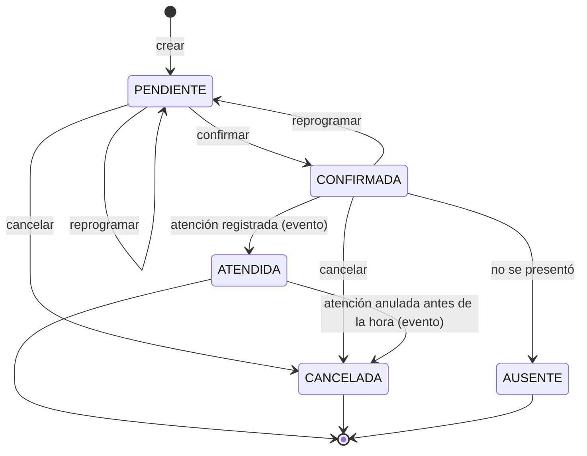

| Estado actual | Transiciones permitidas |
|---|---|
| `PENDIENTE` | `CONFIRMADA`, `CANCELADA`, (reprogramar → `PENDIENTE`) |
| `CONFIRMADA` | `ATENDIDA`, `AUSENTE`, `CANCELADA`, (reprogramar → `PENDIENTE`) |
| `ATENDIDA` | Ninguna por API; `CANCELADA` solo por el sistema si la atención se anula antes de la hora (RN-17) |
| `CANCELADA`, `AUSENTE` | Ninguna (estados finales) |

Cancelar y reprogramar exigen además que falten más de 24 h (RN-15, `409 FUERA_DE_PLAZO`). `ATENDIDA` **no** se alcanza por `PATCH`: solo cuando Atenciones publica `atencion.registrada` (un único camino, RN-05/RN-12). Cualquier otra transición responde `409` con código `TRANSICION_NO_PERMITIDA`. La validación vive en el **dominio** (un tipo con su tabla de transiciones), no en el controlador, para poder probarla de forma unitaria.

## 6.4 Mensajería con RabbitMQ

**Topología**

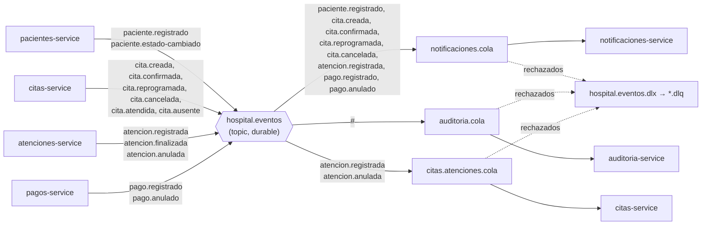

| Elemento | Valor |
|---|---|
| Exchange | `hospital.eventos` — tipo `topic`, durable |
| Routing keys | `paciente.registrado`, `paciente.estado-cambiado`, `cita.creada`, `cita.confirmada`, `cita.reprogramada`, `cita.cancelada`, `cita.atendida`, `cita.ausente`, `atencion.registrada`, `atencion.finalizada`, `atencion.anulada`, `pago.registrado`, `pago.anulado` |
| Cola de Notificaciones | `notificaciones.cola` — bindings explícitos: `paciente.registrado`, `cita.creada`, `cita.confirmada`, `cita.reprogramada`, `cita.cancelada` (y, al final, `atencion.registrada`, `pago.registrado`, `pago.anulado`) |
| Cola de Auditoría | `auditoria.cola` — binding: `#` |
| Cola de Citas | `citas.atenciones.cola` — bindings: `atencion.registrada`, `atencion.anulada` |
| Dead-letter | Exchange `hospital.eventos.dlx` y colas `notificaciones.dlq`, `auditoria.dlq`, `citas.atenciones.dlq` para mensajes que fallan tras 3 reintentos, o de inmediato si no se pueden deserializar |
| Productores | `pacientes-service`, `citas-service`, `atenciones-service`, `pagos-service` |
| Consumidores | `notificaciones-service`, `auditoria-service`, `citas-service` |
| Formato | JSON, `Content-Type: application/json`, UTF-8 |
| Entrega | Mensajes persistentes, colas durables, *ack* manual tras persistir |

**Sobre de evento (envelope común)**

```json
{
  "eventId": "7c1e6b1e-…",
  "tipo": "cita.confirmada",
  "ocurrioEn": "2026-10-12T09:30:00-05:00",
  "origen": "citas-service",
  "tipoRecurso": "CITA",
  "recursoId": "b53a…",
  "estadoAnterior": "PENDIENTE",
  "estadoNuevo": "CONFIRMADA",
  "datos": {
    "codigo": "CIT-20261012-000001",
    "pacienteId": "9f2d…",
    "especialidad": "MEDICINA_GENERAL",
    "especialidadNombre": "Medicina General",
    "fechaHora": "2026-10-15T10:00:00-05:00",
    "profesionalCodigo": "MED-001",
    "motivo": "Confirmada por teléfono"
  }
}
```

El `datos` lleva todo lo que los consumidores necesitan, así **no tienen que llamar de vuelta** al emisor.

**Cómo se evita el acoplamiento directo**

* El productor publica un hecho ("la cita fue confirmada") al *exchange*; **no conoce** quién lo consume, cuántos son ni si están activos.
* Agregar un nuevo consumidor (p. ej. un servicio de reportes) solo requiere una cola nueva con su *binding*; no cambia el emisor.
* Los servicios no comparten clases de dominio ni DTO de eventos: el contrato es el JSON del evento. Solo comparten un módulo técnico, `hospital-commons` (cliente de RabbitMQ, sobre genérico del evento, manejo de errores), sin lógica de negocio.
* Si Notificaciones está caído, los mensajes se acumulan en la cola durable y se procesan al volver.

**Publicación fiable (decisión pragmática).** Se publica el evento *después* de confirmar la escritura en BD. Hay un caso límite: si el servicio muere entre el `commit` y la publicación, el evento se pierde. El patrón *Transactional Outbox* lo resuelve, pero queda **fuera de alcance**; se documenta como mejora (§14).

# 7. Programación reactiva y persistencia

## 7.1 Dónde aporta valor la programación reactiva

* **Citas → Pacientes:** una llamada de red que, en modo bloqueante, retendría un hilo por petición durante la espera. Con `WebClient` + `Mono`, el hilo se libera mientras se espera la respuesta; en horas pico se atienden más peticiones concurrentes con pocos hilos.
* **Acceso a datos:** `R2DBC` evita bloquear hilos del *event loop* de Netty con consultas SQL.
* **Gateway:** Spring Cloud Gateway es reactivo por diseño; el resto del sistema mantiene el mismo modelo.
* **Excepción declarada:** el servidor Eureka (Netflix) corre sobre Servlet/Tomcat; es infraestructura de registro, no participa en el procesamiento de peticiones de negocio.
* **Consumo de eventos:** el procesamiento de mensajes y su persistencia forman una cadena no bloqueante.

**Honestidad técnica.** La programación reactiva no es gratis: complica la depuración y el estilo de código. Se aplica porque el caso de uso (alta concurrencia en horas pico, muchas esperas de E/S) es justamente donde se amortiza.

## 7.2 Uso de tipos reactivos

| Tipo | Uso |
|---|---|
| `Mono<T>` | Operaciones con 0 o 1 resultado: crear paciente, obtener por id, cambiar estado, llamada síncrona a Pacientes. |
| `Flux<T>` | Listas: pacientes filtrados, citas de un paciente, notificaciones, eventos de auditoría. |
| `Mono<Void>` | Operaciones sin resultado (p. ej. publicar un evento tras guardar). |

La cadena es reactiva **de extremo a extremo**: controlador (`WebFlux`) → servicio (`Mono`/`Flux`) → repositorio (`ReactiveCrudRepository` de R2DBC) → PostgreSQL con `r2dbc-postgresql`.

## 7.3 Restricciones de implementación

* Prohibido `.block()`, `.subscribe()` manual dentro del *pipeline* y `Thread.sleep`.
* Prohibido JDBC y JPA/Hibernate (el enunciado marca R2DBC como excluyente).
* Los errores de negocio se modelan como excepciones de dominio traducidas a respuestas HTTP por un *handler* global reactivo.
* Las migraciones de esquema (SQL de creación) se ejecutan al arrancar con un inicializador de R2DBC o un script de init; se evita Flyway/Liquibase porque requieren JDBC.
* La publicación y el consumo de RabbitMQ usan el cliente reactivo `reactor-rabbitmq`, para no bloquear tampoco en los consumidores (que persisten con R2DBC).

## 7.4 Observabilidad (trazas y logs)

El enunciado no la exige, pero en una arquitectura distribuida es la forma de responder "¿qué pasó con esta petición?" y de que el *Administrador del sistema* supervise los servicios.

| Pieza | Decisión |
|---|---|
| Instrumentación | **Agente Java de OpenTelemetry** (2.31.1), cargado con `-javaagent`. Instrumenta automáticamente Gateway, WebFlux, `WebClient`, R2DBC, el cliente de RabbitMQ y Logback. Estándar abierto: API, SDK y protocolo OpenTelemetry, sin dependencia de un proveedor |
| Propagación | W3C `traceparent` entre el Gateway, los servicios y los mensajes de RabbitMQ: el agente instrumenta el cliente AMQP y **una sola traza** cubre `POST` → SQL → publicación → consumo en Notificaciones y Auditoría (verificado, §16) |
| Trazas | Exportadas por OTLP a **Jaeger** (UI `:16686`): árbol de tiempos Gateway → Citas → Pacientes, con las consultas SQL |
| Logs | Consola con `trace_id`/`span_id` y exportación por OTLP a **Seq** (UI `:8090`): se filtran por `TraceId` los logs de todos los servicios de una misma petición |
| Respuesta al cliente | Cabecera `X-Trace-Id` en cada respuesta, para buscar la petición en Jaeger o Seq |
| Salud y métricas | `/actuator/health` con detalle de base de datos, RabbitMQ y Eureka; `/actuator/metrics` |
| Independencia | Si Jaeger o Seq no están disponibles, el negocio funciona igual. Las pruebas y el CI corren sin agente |
| Privacidad | Los logs son los mismos de consola (sin datos personales); no se registran cuerpos ni cabeceras; las sentencias SQL se registran con parámetros enmascarados |

Se descartó Micrometer Tracing: cubre menos de forma automática (no instrumenta `reactor-rabbitmq`, R2DBC exige `r2dbc-proxy`) y su API no es OpenTelemetry.

# 8. Diseño de datos

## 8.1 `pacientes_db`

```sql
CREATE TABLE paciente (
  id                UUID PRIMARY KEY,
  tipo_documento    VARCHAR(15)  NOT NULL CHECK (tipo_documento IN ('DNI','CE','PASAPORTE')),
  numero_documento  VARCHAR(20)  NOT NULL,
  nombres           VARCHAR(80)  NOT NULL,
  apellidos         VARCHAR(80)  NOT NULL,
  fecha_nacimiento  DATE         NOT NULL,
  telefono          VARCHAR(20),
  correo            VARCHAR(120),
  direccion         VARCHAR(200),
  fecha_registro    TIMESTAMPTZ  NOT NULL DEFAULT now(),
  estado            VARCHAR(10)  NOT NULL DEFAULT 'ACTIVO' CHECK (estado IN ('ACTIVO','INACTIVO')),
  CONSTRAINT uq_paciente_documento UNIQUE (tipo_documento, numero_documento)
);
CREATE INDEX ix_paciente_apellidos ON paciente (apellidos);
```

La unicidad por restricción de base de datos es la **garantía final** frente a condiciones de carrera; la verificación previa en código solo mejora el mensaje de error.

## 8.2 `citas_db`

```sql
CREATE TABLE cita (
  id                  UUID PRIMARY KEY,
  codigo              VARCHAR(30)  NOT NULL UNIQUE,
  paciente_id         UUID         NOT NULL,   -- referencia lógica, SIN FK
  especialidad        VARCHAR(30)  NOT NULL,
  fecha_hora          TIMESTAMPTZ  NOT NULL,
  profesional_codigo  VARCHAR(20)  NOT NULL,
  motivo              VARCHAR(200),
  estado              VARCHAR(12)  NOT NULL DEFAULT 'PENDIENTE'
                      CHECK (estado IN ('PENDIENTE','CONFIRMADA','ATENDIDA','CANCELADA','AUSENTE')),
  fecha_creacion      TIMESTAMPTZ  NOT NULL DEFAULT now(),
  fecha_actualizacion TIMESTAMPTZ  NOT NULL DEFAULT now(),
  version             BIGINT       NOT NULL DEFAULT 0   -- bloqueo optimista
);
CREATE SEQUENCE cita_codigo_seq;   -- número correlativo del código legible
-- Un profesional no puede tener dos citas activas a la misma hora
CREATE UNIQUE INDEX ux_cita_profesional_horario
  ON cita (profesional_codigo, fecha_hora) WHERE estado IN ('PENDIENTE','CONFIRMADA');
-- Un paciente no puede tener dos citas activas a la misma hora
CREATE UNIQUE INDEX ux_cita_paciente_horario
  ON cita (paciente_id, fecha_hora) WHERE estado IN ('PENDIENTE','CONFIRMADA');
CREATE INDEX ix_cita_paciente ON cita (paciente_id);
CREATE INDEX ix_cita_estado_fecha ON cita (estado, fecha_hora);
```

Los **índices únicos parciales** convierten RN-06 en una garantía de la base de datos, evitando duplicados incluso con peticiones simultáneas (RN-06 + manejo de la violación de unicidad → `409 CITA_CHOQUE_AGENDA`).

## 8.3 `notificaciones_db` y `auditoria_db`

```sql
CREATE TABLE notificacion (
  id           UUID PRIMARY KEY,
  event_id     UUID         NOT NULL UNIQUE,   -- idempotencia
  paciente_id  UUID,
  tipo_evento  VARCHAR(50)  NOT NULL,
  recurso_id   UUID         NOT NULL,          -- cita, atención, pago… que originó el aviso
  canal        VARCHAR(15)  NOT NULL DEFAULT 'SIMULADO',
  mensaje      VARCHAR(300) NOT NULL,
  fecha_envio  TIMESTAMPTZ  NOT NULL DEFAULT now()
);
CREATE INDEX ix_notificacion_paciente ON notificacion (paciente_id);
CREATE INDEX ix_notificacion_fecha ON notificacion (fecha_envio);

CREATE TABLE evento_auditoria (
  id               UUID PRIMARY KEY,
  event_id         UUID         NOT NULL UNIQUE,   -- idempotencia
  fecha_evento     TIMESTAMPTZ  NOT NULL,
  tipo_evento      VARCHAR(50)  NOT NULL,
  tipo_recurso     VARCHAR(30)  NOT NULL,
  recurso_id       UUID         NOT NULL,
  estado_anterior  VARCHAR(20),
  estado_nuevo     VARCHAR(20),
  origen           VARCHAR(40)  NOT NULL,
  fecha_registro   TIMESTAMPTZ  NOT NULL DEFAULT now()
);
CREATE INDEX ix_auditoria_recurso ON evento_auditoria (tipo_recurso, recurso_id);
CREATE INDEX ix_auditoria_fecha ON evento_auditoria (fecha_evento);

-- Inmutabilidad a nivel de base de datos
CREATE FUNCTION fn_auditoria_inmutable() RETURNS trigger AS $$
BEGIN
  RAISE EXCEPTION 'evento_auditoria es inmutable: % no permitido', TG_OP;
END;
$$ LANGUAGE plpgsql;

CREATE TRIGGER tg_auditoria_sin_update_delete
  BEFORE UPDATE OR DELETE ON evento_auditoria
  FOR EACH ROW EXECUTE FUNCTION fn_auditoria_inmutable();
CREATE TRIGGER tg_auditoria_sin_truncate
  BEFORE TRUNCATE ON evento_auditoria
  FOR EACH STATEMENT EXECUTE FUNCTION fn_auditoria_inmutable();
```

*Nota de implementación:* como el inicializador de Spring separa sentencias por `;` y no reconoce los bloques `$$`, el `schema.sql` de Auditoría usa `@@` como separador.

## 8.4 `atenciones_db` y `pagos_db`

```sql
CREATE TABLE atencion (
  id                   UUID PRIMARY KEY,
  codigo               VARCHAR(30) NOT NULL UNIQUE,
  paciente_id          UUID        NOT NULL,   -- referencia lógica, SIN FK
  cita_id              UUID        NOT NULL,   -- referencia lógica, SIN FK
  fecha_atencion       TIMESTAMPTZ NOT NULL DEFAULT now(),
  area                 VARCHAR(20) NOT NULL
                       CHECK (area IN ('CONSULTA_EXTERNA','EMERGENCIA','TRIAJE','PROCEDIMIENTOS')),
  estado               VARCHAR(12) NOT NULL DEFAULT 'REGISTRADA'
                       CHECK (estado IN ('REGISTRADA','FINALIZADA','ANULADA')),
  fecha_creacion       TIMESTAMPTZ NOT NULL DEFAULT now(),
  fecha_actualizacion  TIMESTAMPTZ NOT NULL DEFAULT now(),
  version              BIGINT      NOT NULL DEFAULT 0   -- bloqueo optimista
);
CREATE SEQUENCE atencion_codigo_seq;
-- Una cita tiene como máximo una atención no anulada
CREATE UNIQUE INDEX ux_atencion_cita_activa ON atencion (cita_id) WHERE estado <> 'ANULADA';
CREATE INDEX ix_atencion_paciente ON atencion (paciente_id);

-- Base pagos_db
CREATE TABLE pago (
  id                UUID PRIMARY KEY,
  numero_operacion  VARCHAR(30)   NOT NULL UNIQUE,
  paciente_id       UUID          NOT NULL,   -- referencia lógica, SIN FK
  cita_id           UUID,                     -- referencia lógica opcional, informativa
  concepto          VARCHAR(120)  NOT NULL,
  monto             NUMERIC(12,2) NOT NULL CHECK (monto > 0 AND monto <= 100000),
  moneda            CHAR(3)       NOT NULL DEFAULT 'PEN' CHECK (moneda = 'PEN'),
  fecha_pago        TIMESTAMPTZ   NOT NULL DEFAULT now(),
  medio_pago        VARCHAR(15)   NOT NULL CHECK (medio_pago IN ('EFECTIVO','TARJETA','TRANSFERENCIA','BILLETERA')),
  estado            VARCHAR(10)   NOT NULL DEFAULT 'REGISTRADO' CHECK (estado IN ('REGISTRADO','ANULADO')),
  motivo_anulacion  VARCHAR(200),
  fecha_actualizacion TIMESTAMPTZ NOT NULL DEFAULT now(),
  version           BIGINT        NOT NULL DEFAULT 0,  -- bloqueo optimista
  clave_idempotencia VARCHAR(64)  NOT NULL UNIQUE,     -- cabecera Idempotency-Key
  huella_solicitud  CHAR(64)      NOT NULL             -- SHA-256 del cuerpo, detecta reutilización
);
CREATE SEQUENCE pago_operacion_seq;   -- número de operación OP-yyyyMMdd-NNNNNN
CREATE INDEX ix_pago_paciente ON pago (paciente_id);
CREATE INDEX ix_pago_fecha ON pago (fecha_pago);
```

Las restricciones `CHECK (monto > 0)` y `UNIQUE (numero_operacion)` son la última línea de defensa de RN-09; la validación en código mejora el mensaje de error.

## 8.5 Mapa de responsabilidades de datos

| Base | Servicio dueño | Referencias externas (solo IDs) |
|---|---|---|
| `pacientes_db` | pacientes-service | — |
| `citas_db` | citas-service | `paciente_id` → Pacientes (por API) |
| `notificaciones_db` | notificaciones-service | `paciente_id` (copiado del evento) |
| `auditoria_db` | auditoria-service | `recurso_id` (copiado del evento) |
| `atenciones_db` | atenciones-service | `cita_id` → Citas, `paciente_id` (copiado de la cita) |
| `pagos_db` | pagos-service | `paciente_id` → Pacientes (por API), `cita_id` (opcional, informativo) |

# 9. Contratos y manejo de errores

## 9.1 Formato de error

Todas las respuestas de error usan el formato estándar **RFC 7807** (`application/problem+json`), con un campo adicional `codigo`:

```json
{
  "type": "about:blank",
  "title": "Conflicto",
  "status": 409,
  "detail": "Ya existe un paciente con el documento DNI 00000001.",
  "codigo": "PACIENTE_DUPLICADO",
  "instance": "/api/pacientes",
  "timestamp": "2026-10-12T09:30:00-05:00"
}
```

## 9.2 Códigos HTTP

| Código | Cuándo |
|---|---|
| `200` | Consulta o actualización correcta |
| `201` | Recurso creado (con cabecera `Location`) |
| `400` | Datos inválidos (campos obligatorios, formatos, fecha fuera del horario) |
| `404` | Recurso inexistente |
| `409` | Conflicto: duplicado, choque de agenda, transición de estado no permitida, modificación concurrente |
| `422` | Regla de negocio sobre una referencia (paciente inactivo) o clave de idempotencia reutilizada con otros datos |
| `503` / `504` | Dependencia síncrona no disponible / agotó el tiempo |

## 9.3 Catálogo de códigos de negocio

`PACIENTE_DUPLICADO`, `PACIENTE_NO_ENCONTRADO`, `PACIENTE_INACTIVO`, `CITA_NO_ENCONTRADA`, `CITA_CHOQUE_AGENDA`, `HORARIO_FUERA_DE_AGENDA`, `TRANSICION_NO_PERMITIDA`, `MISMA_FECHA_HORA`, `FUERA_DE_PLAZO`, `FUERA_DE_VENTANA_ATENCION`, `CONFLICTO_CONCURRENTE`, `VALIDACION_FALLIDA`, `ERROR_INTERNO`, `SERVICIO_PACIENTES_NO_DISPONIBLE`, `SERVICIO_CITAS_NO_DISPONIBLE`, `SERVICIO_NO_DISPONIBLE` (Gateway), `SERVICIO_TIEMPO_AGOTADO` (Gateway), `RUTA_NO_ENCONTRADA` (Gateway), `ATENCION_NO_ENCONTRADA`, `ATENCION_DUPLICADA`, `CITA_NO_CONFIRMADA`, `PAGO_NO_ENCONTRADO`, `MONTO_INVALIDO`, `OPERACION_DUPLICADA`, `PAGO_YA_ANULADO`, `CLAVE_IDEMPOTENCIA_REQUERIDA`, `CLAVE_IDEMPOTENCIA_REUTILIZADA`, `NOTIFICACION_NO_ENCONTRADA`, `EVENTO_AUDITORIA_NO_ENCONTRADO`.

## 9.4 Ejemplos de contrato

**`POST /api/pacientes`**

```json
{
  "tipoDocumento": "DNI",
  "numeroDocumento": "00000001",
  "nombres": "Ana María",
  "apellidos": "Prueba Ficticia",
  "fechaNacimiento": "1990-05-20",
  "telefono": "999000111",
  "correo": "ana.prueba@example.com"
}
```

**`POST /api/citas`**

```json
{
  "pacienteId": "9f2d…",
  "especialidad": "MEDICINA_GENERAL",
  "fechaHora": "2026-10-15T10:00:00-05:00",
  "profesionalCodigo": "MED-001",
  "motivo": "Control administrativo"
}
```

**`POST /api/atenciones`**

```json
{ "citaId": "b53a…", "area": "CONSULTA_EXTERNA" }
```

**`POST /api/pagos`** (cabecera `Idempotency-Key: 3f6c2a1e-7b1d-4a8e-9c55-0d2f1b7a9e10`)

```json
{
  "pacienteId": "9f2d…",
  "citaId": "b53a…",
  "concepto": "Reserva de cita - Medicina General",
  "monto": 80.00,
  "medioPago": "TARJETA"
}
```

Respuesta `201`: el pago con `"numeroOperacion": "OP-20261012-000001"` generado por el servicio.

# 10. Estrategia de pruebas

| Nivel | Qué se prueba | Herramientas |
|---|---|---|
| **Unitarias** (reglas de dominio) | Transiciones de estado (permitidas y prohibidas); validación de horario/agenda; validación de documento; construcción del evento | JUnit 5, AssertJ |
| **Flujos reactivos** | Cadenas `Mono`/`Flux`: éxito, error de negocio, vacío | `reactor-test` (`StepVerifier`) |
| **Controlador** | Endpoints, códigos HTTP y cuerpos de error | `WebTestClient`, servicios simulados (Mockito) |
| **Integración con BD** | Repositorios R2DBC, restricciones únicas, índices parciales | Testcontainers (PostgreSQL) |
| **Integración con mensajería** | Publicación del evento y su consumo, idempotencia por `event_id` | Testcontainers (RabbitMQ) |
| **Contrato síncrono** | Citas ante `200`/`404`/`5xx`/timeout de Pacientes | `MockWebServer` o `WireMock` |

**Casos mínimos del enunciado (§24) → prueba**

| Caso requerido | Servicio | Nivel |
|---|---|---|
| Registro de paciente válido | Pacientes | Controlador + BD |
| Rechazo de paciente duplicado | Pacientes | Controlador + BD (constraint) |
| Registro y consulta de cita | Citas | Controlador + BD |
| Transición de estado no permitida | Citas | Unitaria + controlador |
| Publicación y consumo de un evento | Citas / Notificaciones | Integración con RabbitMQ |
| Validación de monto de pago no permitido (≤ 0) y operación duplicada | Pagos | Unitaria + controlador + BD (constraint) |
| Error ante recurso inexistente | Pacientes y Citas | Controlador |

Casos adicionales de Atenciones: registro sobre cita `CONFIRMADA`; rechazo si la cita no está confirmada o ya tiene atención; Citas no disponible (`503`). Y de integración: `atencion.registrada` → la cita pasa a `ATENDIDA`.

## 10.1 Pruebas manuales con Swagger y Postman (Actividad 10)

* **Swagger/OpenAPI.** Cada servicio de negocio incluye `springdoc-openapi-starter-webflux-ui`; la documentación queda en `http://localhost:<puerto>/swagger-ui.html` (8081, 8082, 8083, 8084, 8085, 8086). El Gateway **no** agrega las especificaciones (se declara como limitación): las rutas oficiales de uso pasan por el puerto 8080.
* **Postman.** Se entrega `docs/postman/hospital-vida-salud.postman_collection.json` y su entorno `hospital-vida-salud.postman_environment.json`, con `baseUrl = http://localhost:8080`. La colección está ordenada como el flujo funcional del enunciado (§28) y guarda en variables los ids de paciente, cita y atención entre peticiones; incluye los casos negativos (duplicado, transición inválida, monto inválido, paciente inexistente).
* **curl.** El README incluye el mismo flujo como secuencia de comandos `curl` para quien no use Postman.

# 11. Integración continua con GitHub Actions

## 11.1 Estructura del repositorio

Monorepo Maven multi-módulo, con `pom.xml` padre en la raíz y Maven Wrapper (`mvnw`) incluido:

```text
hospital-vida-salud/
├── pom.xml                       # padre: versiones y módulos
├── mvnw, .mvn/
├── hospital-commons/             # librería técnica compartida (no es un servicio)
├── eureka-server/
├── api-gateway/
├── pacientes-service/
├── citas-service/
├── atenciones-service/
├── pagos-service/
├── notificaciones-service/
├── auditoria-service/
├── infra/
│   ├── docker-compose.yml        # PostgreSQL, RabbitMQ, Jaeger, Seq
│   └── postgres/init/            # crea una BD y un usuario por servicio
├── scripts/                      # preparar entorno, agente OTel, iniciar/detener todo
├── docs/                         # documento técnico, specs, evidencias, postman/
├── .github/workflows/ci.yml
├── .gitignore
└── README.md
```

## 11.2 Workflow

```yaml
name: Integracion Continua - Hospital Vida Salud

on:
  push:
    branches: [ main ]
  pull_request:
    branches: [ main ]

jobs:
  build-test:
    runs-on: ubuntu-latest
    steps:
      - name: Descargar código
        uses: actions/checkout@v4
      - name: Configurar Java 21
        uses: actions/setup-java@v4
        with:
          distribution: temurin
          java-version: '21'
          cache: maven
      - name: Compilar y ejecutar pruebas (todos los módulos)
        run: ./mvnw --batch-mode verify
      - name: Publicar reportes de pruebas
        if: always()
        uses: actions/upload-artifact@v4
        with:
          name: surefire-reports
          path: '**/target/surefire-reports'
```

**Decisiones**

* **Un solo job para todos los módulos.** El `pom.xml` padre compila y prueba los nueve módulos (incluye `hospital-commons`) en un comando, con orden de reactor automático. Es lo más simple y suficiente; un *matrix* por módulo sería excesivo.
* **Testcontainers** funciona en `ubuntu-latest` (Docker incluido), por lo que PostgreSQL y RabbitMQ para las pruebas de integración no requieren configuración extra en el YAML.
* **Sin secretos.** Las pruebas usan credenciales efímeras de contenedores de prueba. Nada sensible en el YAML.
* **Caché de Maven** con `cache: maven` para acelerar ejecuciones.
* **Separación CI/CD.** La construcción de imágenes Docker, si se hace, irá en un workflow aparte, protegido por secretos (enunciado §25.5).

## 11.2.1 Ramas y políticas de rama

Flujo de integración: `feature/*` → `dev` → `stage` → `main`.

| Rama | Propósito | Política (aplicada también al dueño del repositorio) |
|---|---|---|
| `dev` | Integración continua del trabajo diario | Solo por *pull request*; el check `build-test` debe estar en verde y actualizado |
| `stage` | Validación previa a producción | Igual que `dev` |
| `main` | Versión estable | Igual que `dev`; sin *push* directo, sin *force-push* ni borrado |

* El workflow se ejecuta en cada *push* y *pull request* de las tres ramas (`on: push/pull_request` sobre `main`, `stage` y `dev`).
* Los *merges* son con commit de integración (sin *squash*), para conservar el historial de commits pequeños.
* Evidencia: un *push* directo a `main` es rechazado por GitHub (`GH006: Protected branch update failed... Changes must be made through a pull request`), ver `docs/evidencias/push-directo-rechazado.txt`.

## 11.3 Qué ocurre cuando algo falla

1. `./mvnw verify` retorna código distinto de cero si falla la compilación o una prueba.
2. El *job* queda en **rojo** ✗ y, en un *pull request*, GitHub muestra el fallo junto al PR.
3. Con **protección de rama** (`main` exige que el check `build-test` esté verde para fusionar), un PR defectuoso **no puede integrarse**.
4. El desarrollador revisa los logs en la pestaña *Actions*, corrige y vuelve a hacer *push*; el workflow se reejecuta hasta quedar en verde.

## 11.4 Demostración del ciclo con fallo controlado

1. Crear rama `demo/ci-fallo`.
2. Romper deliberadamente una prueba (p. ej. cambiar el resultado esperado de una transición) y hacer *push* → abrir PR a `main`.
3. Capturar el workflow en **rojo** y el log de la prueba fallida.
4. Corregir la prueba en un nuevo *commit* en la misma rama → el workflow pasa a **verde**.
5. Capturar la ejecución exitosa y fusionar.

# 12. Seguridad, privacidad y datos de prueba

* Solo datos **ficticios** (documentos con patrón `0000xxxx`, correos `@example.com`).
* **Sin secretos en el repositorio.** Las credenciales de BD y RabbitMQ se leen de variables de entorno (`${DB_PASSWORD}`, `${RABBIT_PASSWORD}`); se entrega `infra/.env.example` con valores de ejemplo, y `.env` real está en `.gitignore`.
* Los logs **no** imprimen documento, teléfono, correo ni dirección; solo identificadores.
* Los servicios internos no se exponen al exterior; el único puerto público de la aplicación es el del Gateway.

# 13. Cómo ejecutar la solución y las pruebas

*Comandos verificados en la máquina de desarrollo (Ubuntu 24.04, JDK 21, Docker 29).*

```bash
# 1. Infraestructura (PostgreSQL, RabbitMQ, Jaeger, Seq)
scripts/preparar-entorno.sh          # crea infra/.env con contraseñas aleatorias (no versionado)
docker compose -f infra/docker-compose.yml up -d
source scripts/entorno-dev.sh        # exporta variables para los servicios
scripts/descargar-otel-agent.sh      # agente OpenTelemetry (trazas y logs)

# 2. Compilar y probar
./mvnw verify

# 3. Arrancar todo con el agente OTel (recomendado):
./mvnw -DskipTests package && scripts/iniciar-todo.sh
#    o solo algunos: scripts/iniciar-todo.sh eureka-server api-gateway pacientes-service
#    o uno por uno, en este orden (sin trazas):
./mvnw -pl eureka-server spring-boot:run
./mvnw -pl api-gateway spring-boot:run
./mvnw -pl pacientes-service spring-boot:run
./mvnw -pl citas-service spring-boot:run
./mvnw -pl atenciones-service spring-boot:run
./mvnw -pl pagos-service spring-boot:run
./mvnw -pl notificaciones-service spring-boot:run
./mvnw -pl auditoria-service spring-boot:run

# 4. Verificar
#   Eureka:    http://localhost:8761
#   RabbitMQ:  http://localhost:15672
#   Swagger:   http://localhost:808x/swagger-ui.html (cada servicio)
#   Postman:   docs/postman/
#   Jaeger:    http://localhost:16686   (trazas; buscar el X-Trace-Id de una respuesta)
#   Seq:       http://localhost:8090    (logs; filtrar TraceId = '...')
```

# 14. Limitaciones y mejoras futuras

| Tema | Estado actual | Mejora |
|---|---|---|
| Autenticación/autorización | No implementada | JWT validado en el Gateway; roles por actor |
| Fiabilidad de eventos | Publicar tras `commit` | *Transactional Outbox* |
| Consistencia entre servicios | Reglas de negocio que evitan la carrera atención/cancelación + DLQ | Saga con compensación |
| Tolerancia a fallos síncronos | Timeout + 1 reintento | *Circuit breaker* (Resilience4j) |
| Aislamiento de BD | Una instancia, una BD por servicio | Instancia por servicio |
| Métricas | `/actuator/metrics` sin backend | Exportar métricas por OTLP a Prometheus/Grafana |
| Trazas | Jaeger en memoria (se pierden al reiniciar); muestreo 100 % | Almacenamiento persistente; muestreo parcial en producción |
| Traza a través de RabbitMQ | Funciona con el agente OTel sin código propio; depende de que los servicios se ejecuten con el agente | — |
| Retención de logs en Seq | Sin política | Retención configurada en Seq |
| Configuración | Variables de entorno | Spring Cloud Config |
| Tiempos de Eureka | Autopreservación desactivada y latidos de 5 s para que la demostración muestre bajas rápido | Valores por defecto en producción |
| Exposición de actuator | `/actuator/gateway/routes` expuesto como evidencia | No exponerlo en producción |
| Paginación | `pagina`/`tamano` con total en `X-Total-Count` | Paginación por cursor para volúmenes grandes |
| Servicios restantes (Laboratorio, Hospitalización, Farmacia) | Diseñados en §5.8 | Implementarlos con el mismo patrón |
| Swagger agregado | Una UI por servicio | Agregación de especificaciones en el Gateway |
| Cargos de facturación | Solo pagos con concepto | Entidad `cargo` separada |
| Pipeline y Dockerfile compartidos | Un solo workflow y un `Dockerfile` parametrizado para los 8 módulos del monorepo (el enunciado §25.4 admite un único workflow que compile y pruebe todos los módulos); los servicios son independientes en datos, contratos y código, pero no tienen pipelines de despliegue separados | Un workflow por módulo con filtros de rutas y un Dockerfile por servicio, si los servicios pasaran a repositorios o equipos distintos |
| Claves de idempotencia | Se guardan sin expiración | Depurarlas tras 24–72 h |
| Retención de auditoría y notificaciones | Los registros se conservan indefinidamente; suficiente a la escala académica | Política de retención: archivado/depuración periódica según normativa (p. ej. particionar por mes y archivar) |
| Propiedad de la tabla de auditoría | La crea `auditoria_user`, que como dueño podría eliminar los *triggers* | Tabla de un rol administrador; el servicio solo con `INSERT`/`SELECT` |
| Pago y reserva | Confirmar una cita no exige pago | Regla "cita pagada para confirmar" vía consulta o evento de Pagos |
| Despliegue | Docker Compose local | Imágenes en un registro y despliegue automatizado |

**Notas de ejecución**

* Seq exige cambiar la contraseña de `admin` en el primer acceso (la inicial es `SEQ_ADMIN_PASSWORD` de `infra/.env`).
* Si la máquina se reinicia, los contenedores vuelven solos (`restart: unless-stopped`); los procesos Java se levantan de nuevo con `scripts/iniciar-todo.sh`.
* Para demostrar el sistema un día u hora fuera de la agenda (por defecto lunes a sábado, 08:00–17:30), arranque Citas con `AGENDA_DIAS_ATENCION`, `AGENDA_HORA_INICIO` y `AGENDA_HORA_ULTIMO_INICIO`.

# 15. Plan de implementación y trazabilidad con la rúbrica

## 15.1 Orden de construcción

1. Infraestructura (Compose: PostgreSQL y RabbitMQ) y proyecto padre Maven.
2. `eureka-server` y `api-gateway`.
3. `pacientes-service` (con pruebas).
4. `citas-service` (llamada síncrona, máquina de estados, pruebas).
5. Eventos: publicación en Pacientes/Citas.
6. `notificaciones-service` (eventos de paciente y cita) y `auditoria-service`.
7. `atenciones-service` (llamada síncrona a Citas, evento `atencion.registrada`, consumidor en Citas).
8. `pagos-service` (llamada síncrona a Pacientes, validaciones de monto y operación).
9. Observabilidad: Jaeger y Seq en Compose, agente OTel en los scripts, `X-Trace-Id`, health con detalle.
10. Workflow de CI, Swagger, colección Postman, README y evidencias.
11. Repositorio en GitHub y ciclo de fallo controlado.
12. **Prioridad baja, al final:** traza continua a través de RabbitMQ; notificaciones de `atencion.registrada` y `pago.*`; guía de sustentación; Dockerfiles de servicios (opcional).

Se hacen **commits locales pequeños y descriptivos** durante todo el proceso (enunciado §25.3), con el repositorio remoto agregado al final.

## 15.2 Rúbrica → dónde se cumple

| # | Criterio | Pts | Evidencia / sección |
|---|---|---|---|
| 1 | Análisis del problema | 2 | §1, §2 |
| 2 | Reglas de negocio | 2 | §2.3, §6.3, pruebas unitarias |
| 3 | Identificación de microservicios | 2 | §3, §5 |
| 4 | Diseño de arquitectura | 2 | §4, diagramas |
| 5 | Spring Cloud Gateway | 1.5 | §5.2; captura de petición enrutada |
| 6 | Eureka | 1.5 | §4.3, §5.1; captura del panel |
| 7 | RabbitMQ | 2 | §6.4; captura del panel + log del consumidor |
| 8 | Reactiva y R2DBC | 2 | §7, §8 |
| 9 | Pruebas automatizadas | 1 | §10; reporte de Surefire |
| 10 | CI | 2 | §11; capturas rojo/verde |
| 11 | Documentación, evidencias, sustentación | 1.5 | Este documento, README, carpeta `docs/evidencias`; observabilidad (§7.4) como valor agregado |

## 15.3 Lista de evidencias a capturar

- [ ] Panel de Eureka con los 7 clientes registrados (gateway y los seis servicios).
- [ ] Petición por el Gateway (`curl`/Postman) a pacientes y a citas.
- [ ] Registro de paciente, consulta por id y rechazo del duplicado (`409`).
- [ ] Creación de cita, consulta y cambio de estado válido e inválido (`409`).
- [ ] Llamada síncrona Citas → Pacientes (log) y comportamiento con Pacientes detenido (`503`).
- [ ] Panel de RabbitMQ: exchange, colas y mensaje publicado y consumido.
- [ ] Atención registrada sobre cita confirmada, rechazo sobre cita no confirmada y cita pasando a `ATENDIDA` por evento.
- [ ] Cancelación a menos de 24 h rechazada (`409 FUERA_DE_PLAZO`); atención a más de 30 min de la cita rechazada (`409 FUERA_DE_VENTANA_ATENCION`); atención anulada antes de la hora → cita `CANCELADA`.
- [ ] Pago registrado, rechazo por monto ≤ 0 (`400`) y reintento con la misma `Idempotency-Key` que devuelve el mismo pago sin duplicarlo.
- [ ] Swagger UI de un servicio y colección Postman ejecutada.
- [ ] Registros en las tablas `notificacion` y `evento_auditoria`.
- [ ] Tablas en PostgreSQL con datos (persistencia vía R2DBC).
- [ ] Salida de `./mvnw verify` local con todas las pruebas en verde.
- [ ] GitHub Actions: ejecución exitosa.
- [ ] GitHub Actions: ejecución fallida controlada y su corrección.
- [ ] Jaeger: traza de `POST /api/citas` (Gateway → Citas → Pacientes, con SQL) y traza con Pacientes caído (`503`).
- [ ] Seq: logs de varios servicios filtrados por un mismo `TraceId`.

# 16. Resultados de la verificación

Los resultados corresponden a la ejecución real de la solución; las capturas y salidas están en [`docs/evidencias/`](evidencias/README.md).

## 16.1 Pruebas automatizadas

`./mvnw --batch-mode verify` en la raíz: **BUILD SUCCESS** en los 9 módulos, 0 fallos, 0 errores.

| Módulo | Pruebas | Tipo |
|---|---|---|
| `hospital-commons` | 29 | unitarias + integración con RabbitMQ real |
| `eureka-server` | 3 | arranque y registro |
| `api-gateway` | 6 | rutas, enrutamiento, errores |
| `pacientes-service` | 72 | unitarias, controlador, PostgreSQL y RabbitMQ reales |
| `citas-service` | 105 | ídem, incluida la matriz completa de transiciones |
| `atenciones-service` | 61 | ídem |
| `pagos-service` | 80 | ídem, incluida idempotencia concurrente |
| `notificaciones-service` | 45 | ídem |
| `auditoria-service` | 48 | ídem, incluidos los *triggers* de inmutabilidad |
| **Total** | **449** | |

Los casos del enunciado §24 están cubiertos: registro válido, rechazo de duplicado, registro y consulta de cita, transición no permitida, publicación y consumo de un evento, monto de pago inválido y recurso inexistente.

## 16.2 Flujo funcional de punta a punta

La colección de Postman (`docs/postman/`) ejecutada con Newman contra el Gateway y los 8 procesos reales: **49 peticiones, 86 aserciones, 0 fallos**. Cubre el flujo del enunciado §27/§28: paciente → duplicado rechazado → cita → choque de agenda → confirmación → evento → atención → cita `ATENDIDA` por evento → anulación (la cita pasa a `CANCELADA`) → pagos con idempotencia → notificaciones y auditoría.

## 16.3 Resiliencia

Con `pacientes-service` detenido:

* `POST /api/citas` responde `503 SERVICIO_PACIENTES_NO_DISPONIBLE` (con el servicio aún en Eureka y también una vez expulsado), sin crear la cita.
* `GET /api/citas` y el resto de operaciones que no dependen de Pacientes siguen funcionando.
* Al volver a arrancar, el servicio se registra de nuevo en Eureka y se reanuda el flujo.

## 16.4 Observabilidad

Una petición `POST /api/pacientes` por el Gateway produce **una traza de 17 *spans*** en Jaeger: Gateway → Pacientes → consultas SQL (R2DBC) → publicación en RabbitMQ → consumo en Notificaciones y en Auditoría, con sus `INSERT`. En Seq, filtrando por ese `TraceId`, aparecen los logs de los tres servicios. La respuesta HTTP incluye `X-Trace-Id` para localizar la petición.

# Anexo A. Evidencias

Capturas generadas con `scripts/capturar-evidencias.js` sobre el sistema en ejecución (índice completo en [`docs/evidencias/`](evidencias/README.md)).

**A.1 Eureka: las 7 instancias registradas**

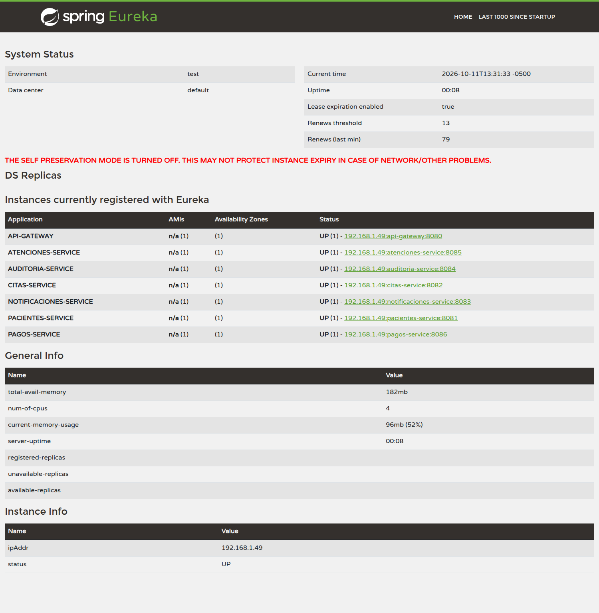

**A.2 API Gateway: rutas `lb://` hacia los servicios**

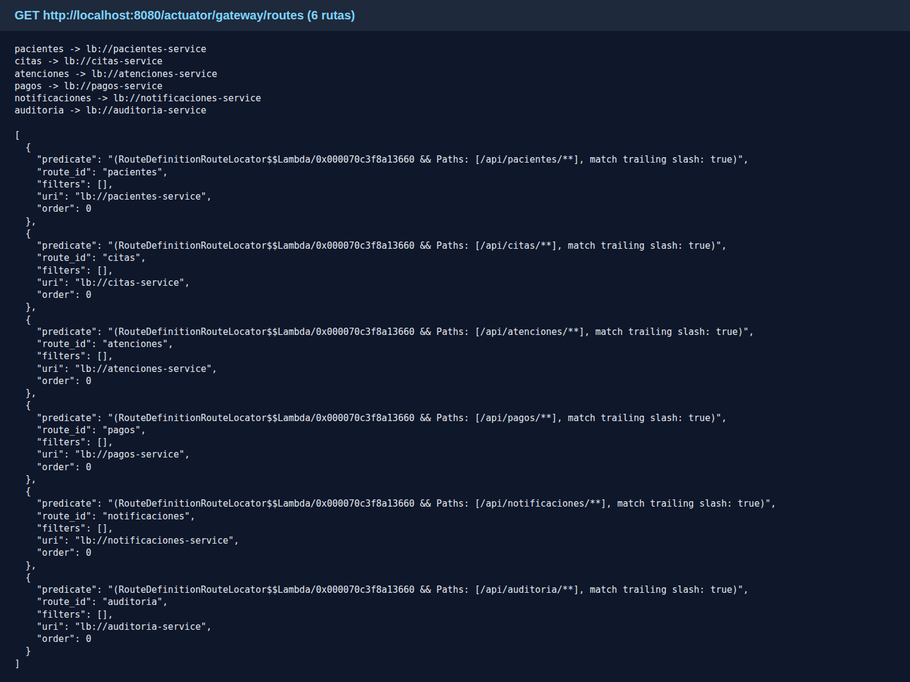

**A.3 Salud del servicio de citas (base de datos, RabbitMQ y Eureka)**

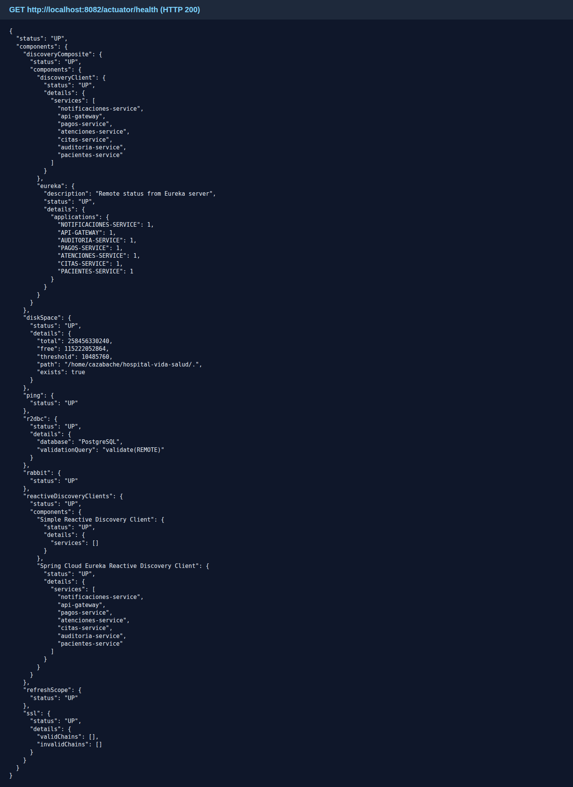

**A.4 Flujo funcional completo por el Gateway (Newman: 49 peticiones, 86 aserciones, 0 fallos)**

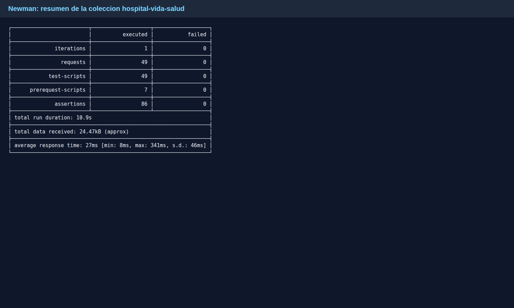

**A.5 Documentación interactiva (Swagger UI)**

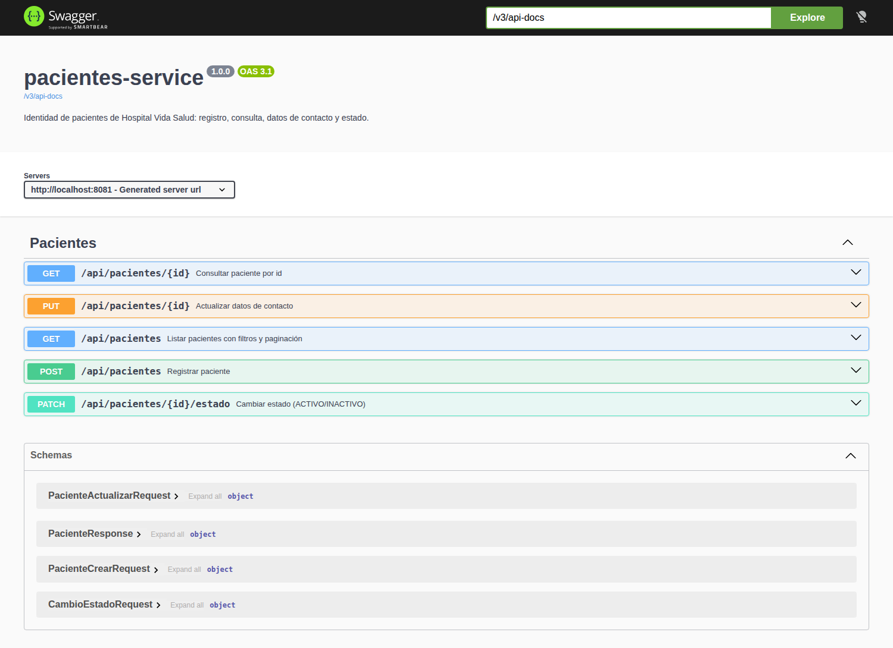

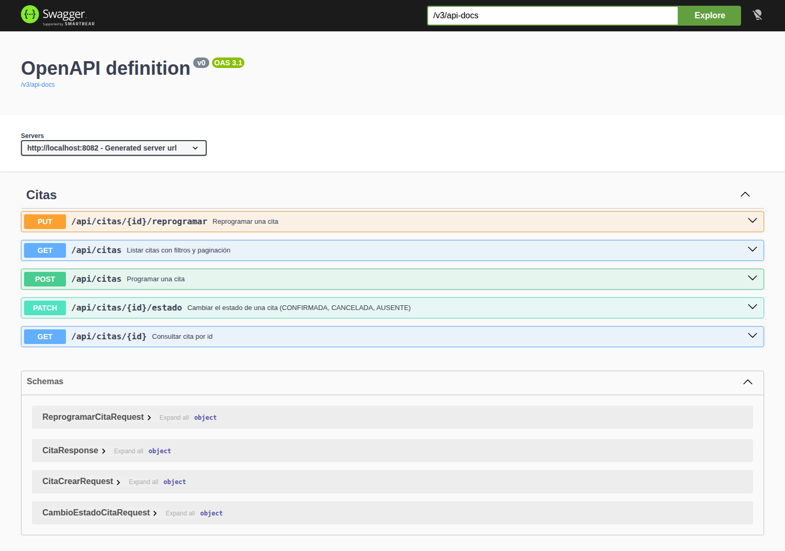

**A.6 Trazas distribuidas en Jaeger**

Crear una cita: Gateway → Citas → Pacientes (llamada síncrona) con las consultas SQL de R2DBC.

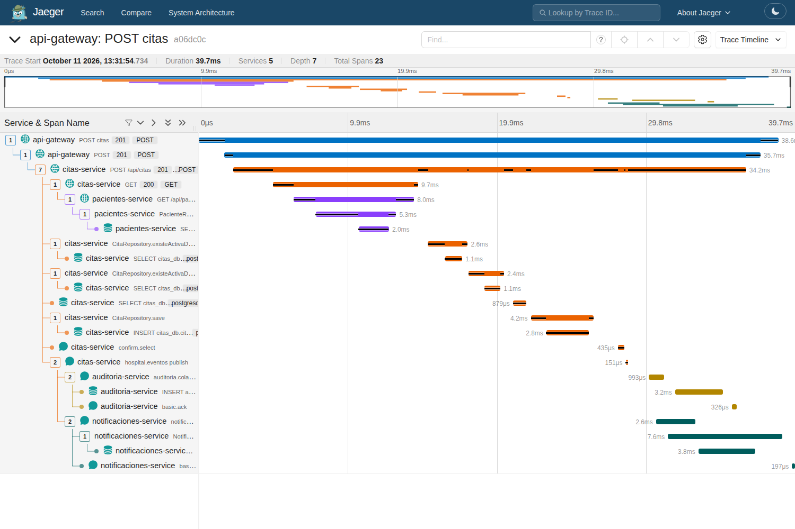

Confirmar una cita: la traza continúa por RabbitMQ hasta los consumidores de Notificaciones y Auditoría.

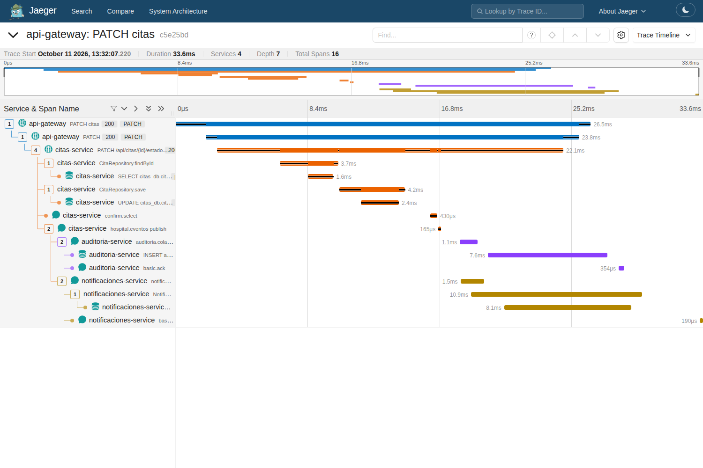

Con Pacientes caído: el servicio de citas responde `503` y la traza muestra el *span* fallido.

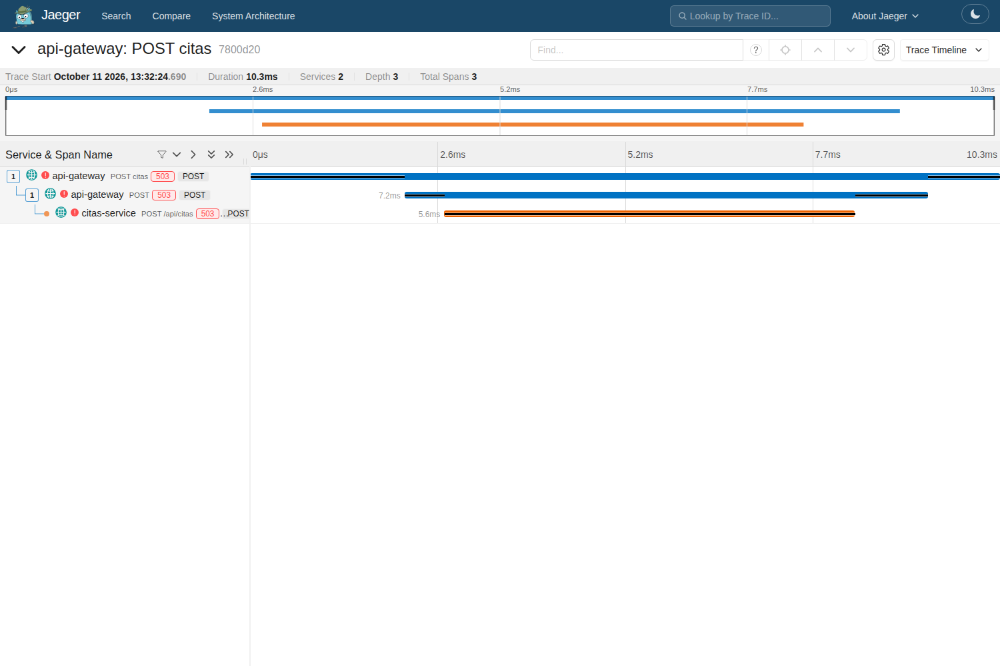

**A.7 Logs centralizados en Seq, filtrados por `TraceId`**

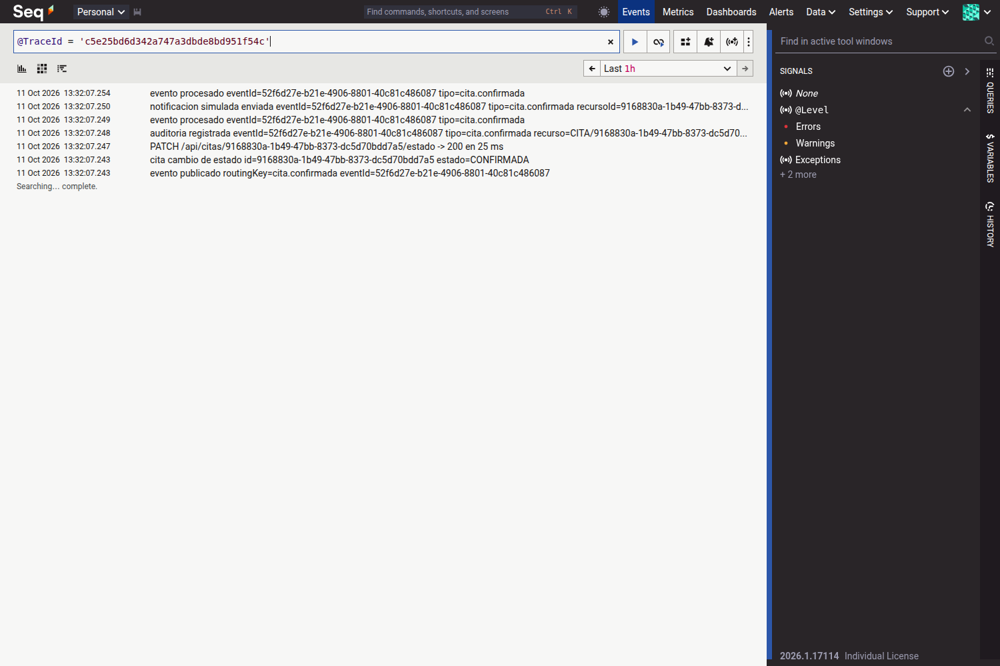

**A.8 RabbitMQ: exchange `hospital.eventos` y colas**

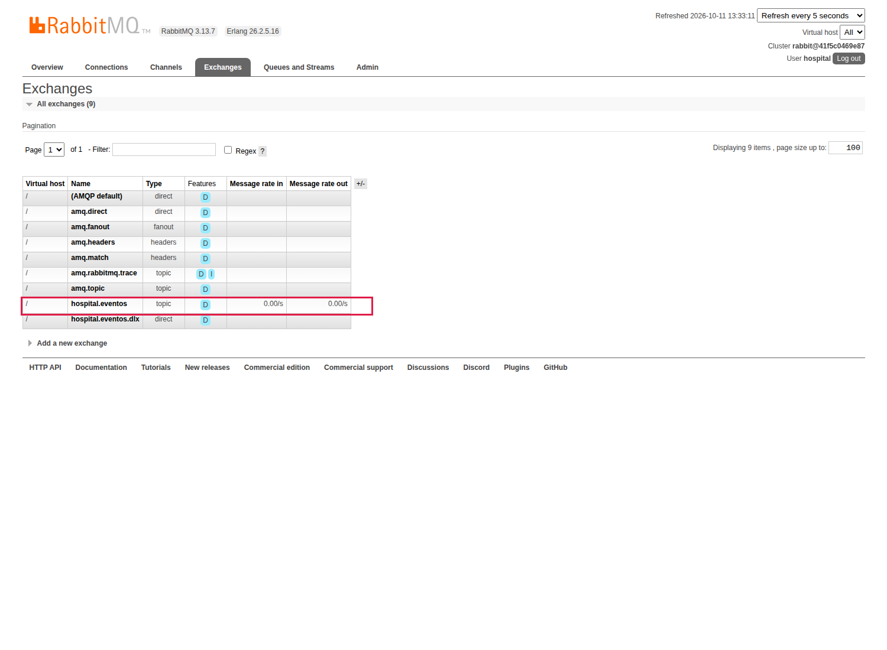

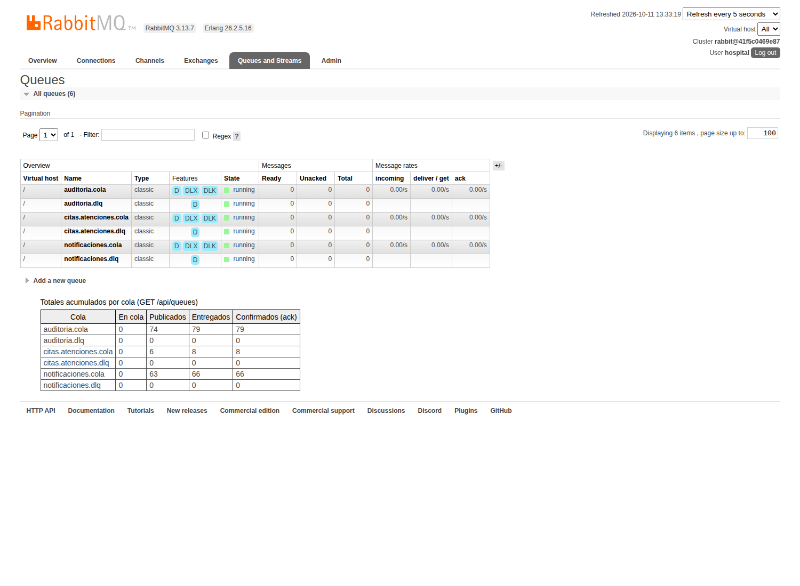

**A.9 Persistencia SQL con R2DBC y trigger de inmutabilidad de la auditoría**

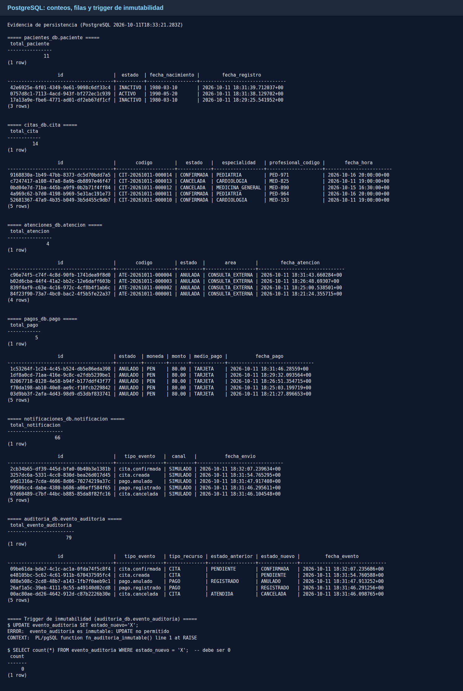
