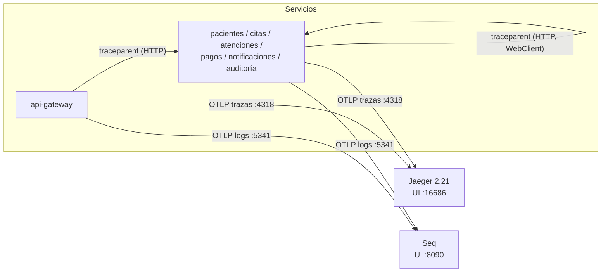

# Spec 08 — Observabilidad: trazas distribuidas (Jaeger) y logs centralizados (Seq)

> Depende de: spec 00, spec 01. Afecta a: `api-gateway` y todos los servicios de negocio (y logs de `eureka-server`).
> El enunciado **no** la exige (ningún criterio de rúbrica); se incluye porque en microservicios es la forma de responder "¿qué pasó con esta petición?" y sostiene al actor *Administrador del sistema: supervisa los servicios y sus estados* (enunciado §4). Documento técnico: nueva §7.4 y §14.

## 1. Alcance por niveles

| Nivel | Contenido | Prioridad |
|---|---|---|
| **1** | Micrometer Tracing con **puente OpenTelemetry** y propagación **W3C `traceparent`**; `traceId`/`spanId` en todos los logs; health con detalle; métricas expuestas | **Ahora** |
| **2** | Exportación de **trazas a Jaeger** y de **logs a Seq**, ambos por **OTLP** | **Ahora** |
| 3 | Continuar la traza a través de RabbitMQ (`traceparent` en cabeceras AMQP) | Baja, al final |

## 2. Diseño



* **Un solo estándar (OpenTelemetry/OTLP)** para trazas y logs: no hay agentes ni formatos propietarios; cambiar Jaeger o Seq por otro backend OTLP es configuración.
* **Propagación W3C `traceparent`**: el Gateway inicia (o continúa) la traza y la propaga; `WebClient` la propaga en las llamadas síncronas (Citas → Pacientes, Atenciones → Citas, Pagos → Pacientes).
* Cada log lleva `traceId` y `spanId`; en Seq se filtra por `TraceId` y se ven **los logs de todos los servicios** de una misma petición; en Jaeger se ve el **árbol de tiempos**.
* **Si Jaeger o Seq no están levantados, los servicios funcionan igual**: los exportadores registran una advertencia y descartan los datos. La observabilidad no es una dependencia del negocio.

## 3. Módulo `hospital-observabilidad` (nuevo, librería)

Se crea un módulo pequeño aparte de `hospital-commons` porque el **Gateway** también lo necesita y no debe depender de `hospital-commons` (spec 01). Orden en el padre: justo después de `hospital-commons`.

| Contenido | Detalle |
|---|---|
| Dependencias que aporta | `spring-boot-starter-actuator`, `io.micrometer:micrometer-tracing-bridge-otel`, `io.opentelemetry:opentelemetry-exporter-otlp`, `io.opentelemetry.instrumentation:opentelemetry-logback-appender-1.0` (versión `-alpha` compatible con el SDK de OpenTelemetry gestionado por Boot 3.5.16; se fija y verifica al construir) |
| `logback-spring.xml` | En la raíz de recursos del módulo: *appender* de consola (patrón por defecto de Boot, que ya incluye `[aplicación,traceId,spanId]`) **y** *appender* `OpenTelemetryAppender` (envía cada log por OTLP, con `traceId`/`spanId` adjuntos y `captureMdcAttributes` desactivado salvo `traceId`/`spanId`). Los servicios **no** definen su propio `logback-spring.xml` |
| `ObservabilidadAutoConfiguration` | Al arrancar, `OpenTelemetryAppender.install(openTelemetry)` con el bean `OpenTelemetry` que crea Boot. Registrada en `AutoConfiguration.imports` |
| `TraceIdRespuestaFilter` (`WebFilter`) | Agrega a **cada respuesta HTTP** la cabecera `X-Trace-Id` con el `traceId` actual: el cliente (o el profesor en Postman) puede buscar esa petición en Jaeger y en Seq. Solo se registra en aplicaciones reactivas |

## 4. Configuración (común, en cada `application.yml`)

```yaml
spring:
  reactor:
    context-propagation: auto        # MDC/traza correctos en cadenas Reactor
management:
  tracing:
    sampling:
      probability: 1.0               # 100 %: escala académica (en producción se reduce)
    propagation:
      type: w3c                      # cabecera traceparent
  otlp:
    tracing:
      endpoint: ${OTLP_TRACES_URL:http://localhost:4318/v1/traces}      # Jaeger
    logging:
      endpoint: ${OTLP_LOGS_URL:http://localhost:5341/ingest/otlp/v1/logs}  # Seq
  endpoints:
    web:
      exposure:
        include: health,info,metrics
  endpoint:
    health:
      show-details: always           # demostración; en producción "when-authorized"
  observations:
    key-values:
      sistema: hospital-vida-salud
```

* El Gateway expone además `gateway` (spec 01 D-8).
* **`WebClient` con trazas:** el `@LoadBalanced WebClient.Builder` de cada servicio se crea a partir del *builder* autoconfigurado por Boot (inyectando `WebClient.Builder` y clonándolo con `.clone()`), para conservar la instrumentación de observaciones. Un `WebClient.builder()` creado a mano **perdería** la propagación (ajuste a spec 00 §5.3).
* **Perfil `test` y CI:** `management.tracing.enabled=false` y sin exportadores (los endpoints OTLP no existen en el runner de GitHub).
* `eureka-server` (servlet): solo envía logs a Seq (mismo módulo; el `WebFilter` no aplica).

## 5. Health y métricas

| Endpoint | Contenido |
|---|---|
| `/actuator/health` | `UP`/`DOWN` con detalle: `r2dbc` (conexión a su base, automático), `rabbit` (indicador propio en `hospital-commons`: `UP` si la conexión de `reactor-rabbitmq` está abierta), `discoveryComposite` (Eureka) |
| `/actuator/metrics` | Métricas de Micrometer: `http.server.requests`, `http.client.requests` (llamadas síncronas), JVM, pool R2DBC |

Las métricas **no** se envían a un backend (Prometheus/Grafana quedan como mejora, §14).

## 6. Infraestructura (`infra/docker-compose.yml`, se agrega)

```yaml
  jaeger:
    image: jaegertracing/jaeger:2.21.0
    container_name: hvs-jaeger
    ports:
      - "127.0.0.1:16686:16686"   # UI
      - "127.0.0.1:4318:4318"     # OTLP HTTP
  seq:
    image: datalust/seq:2026.1.17114
    container_name: hvs-seq
    environment:
      ACCEPT_EULA: "Y"
      SEQ_FIRSTRUN_ADMINPASSWORD: ${SEQ_ADMIN_PASSWORD}
    ports:
      - "127.0.0.1:8090:80"       # UI
      - "127.0.0.1:5341:5341"     # ingesta (incluye OTLP)
    volumes:
      - hvs-seqdata:/data
```

* `infra/.env.example` agrega `SEQ_ADMIN_PASSWORD=cambiar-esto`; `preparar-entorno.sh` la genera aleatoria.
* Jaeger guarda las trazas **en memoria** (se pierden al reiniciar; suficiente para la demo). Seq persiste en volumen.
* La ingesta en Seq no exige API key en local; con autenticación se agregaría `management.otlp.logging.headers.X-Seq-ApiKey=${SEQ_API_KEY}` (sin valor en el repositorio).
* Seq es gratuito para uso individual/desarrollo (licencia del proveedor).

## 7. Privacidad

* Los logs que llegan a Seq son **los mismos** de la consola: ya cumplen la regla de no incluir documento, nombres, teléfono ni correo (spec 00 §8).
* **No** se registran cuerpos ni cabeceras de peticiones. Las trazas solo llevan atributos técnicos (método, ruta con plantilla `/api/citas/{id}`, estado, servicio).
* Los ids de recurso (UUID) sí aparecen: son la base de la trazabilidad.

## 8. Cambios en otras specs

| Spec | Cambio |
|---|---|
| 00 §5.3 | `WebClient.Builder` balanceado construido desde el *builder* autoconfigurado (§4) |
| 00 §5 | `hospital-commons` agrega `RabbitHealthIndicator` |
| 00 §2 | Nuevo módulo `hospital-observabilidad` (10 módulos en total) |
| 01 §5.2 | **Se elimina** `IdCorrelacionFilter` y la cabecera `X-Request-Id`: la sustituyen `traceparent` (entre servicios) y `X-Trace-Id` (hacia el cliente). `RegistroPeticionesFilter` se mantiene y su log ya lleva `traceId` |
| 01 §3 | Compose con `jaeger` y `seq`; `.env.example` con `SEQ_ADMIN_PASSWORD` |
| 01 §8 / 03 §4 / 04 §4 | Donde dice "propaga `X-Request-Id`" pasa a "propaga `traceparent` (automático)" |

## 9. Nivel 3 (prioridad baja): traza a través de RabbitMQ

`reactor-rabbitmq` no instrumenta mensajes. Para continuar la traza:

* `PublicadorRabbit`: inyecta el contexto actual en las cabeceras AMQP con el `Propagator` de Micrometer (`traceparent`).
* `ConsumidorEventos`: extrae el contexto de las cabeceras y abre un *span* hijo `consumir <routing key>` alrededor del manejador.
* Resultado: en Jaeger, una sola traza `POST /api/citas/{id}/estado` → `publicar cita.confirmada` → `consumir` en Notificaciones **y** en Auditoría.

Mientras no se implemente, **la traza se corta en la mensajería** (cada consumo aparece como traza separada); se documenta como limitación.

## 10. Pruebas

| Prueba | Verificación |
|---|---|
| `TraceIdRespuestaFilterTest` (en el módulo) | Con un `Tracer` de prueba (`micrometer-tracing-test`), la respuesta incluye `X-Trace-Id` con el id del *span* actual |
| `RabbitHealthIndicatorTest` (commons) | Conexión abierta → `UP`; cerrada → `DOWN` |
| `EnrutamientoTest` (Gateway, spec 01) | Se ajusta: la petición que llega al `MockWebServer` trae cabecera `traceparent` y la respuesta trae `X-Trace-Id` |
| Nivel 3 (si se hace) | IT: el mensaje publicado lleva `traceparent` y el consumidor continúa el mismo `traceId` |

El resto se valida con **evidencias** (§11), no con pruebas automatizadas: depende de Jaeger y Seq reales.

## 11. Criterios de aceptación y evidencias

- [ ] `docker compose up -d` levanta `hvs-jaeger` y `hvs-seq`; UIs en `http://localhost:16686` y `http://localhost:8090`.
- [ ] `POST /api/citas` vía Gateway devuelve `X-Trace-Id`; buscando ese id en **Jaeger** se ve la traza `api-gateway` → `citas-service` → `pacientes-service` con sus tiempos (**captura**).
- [ ] En **Seq**, filtrando `TraceId = '<id>'`, aparecen los logs de Gateway, Citas y Pacientes de esa petición (**captura**).
- [ ] Con Pacientes detenido, la traza en Jaeger muestra el error del *span* de la llamada y el `503` (**captura**: diagnóstico de fallos).
- [ ] `/actuator/health` de un servicio muestra `r2dbc`, `rabbit` y `discoveryComposite` en `UP`.
- [ ] Con Jaeger y Seq detenidos, el flujo funcional sigue funcionando (solo advertencias en consola).
- [ ] `./mvnw verify` en verde sin Jaeger ni Seq (CI).

## 12. Decisiones abiertas para revisión

| # | Decisión tomada | Alternativa |
|---|---|---|
| D-43 | Micrometer Tracing con puente **OpenTelemetry** y exportación **OTLP** a Jaeger v2 | Puente Brave + Zipkin |
| D-44 | Logs a **Seq por OTLP** (`OpenTelemetryAppender` de Logback), además de la consola | GELF con un contenedor `seq-input-gelf` adicional |
| D-45 | Nuevo módulo `hospital-observabilidad` compartido por Gateway y servicios | Duplicar la configuración en cada módulo |
| D-46 | Muestreo 100 % y health con detalle siempre (demostración) | Muestreo parcial / detalle solo autorizado |
| D-47 | Se elimina el `X-Request-Id` casero; `traceparent` + `X-Trace-Id` en la respuesta | Mantener ambos |
| D-48 | Nivel 3 (traza a través de RabbitMQ) con prioridad baja; si no se hace, se documenta | Hacerlo ahora |
