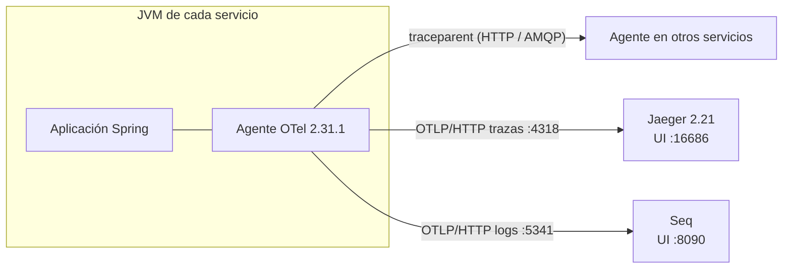

# Spec 08 — Observabilidad con OpenTelemetry: trazas en Jaeger y logs en Seq

> Depende de: spec 00, spec 01. Afecta a: `api-gateway`, servicios de negocio y `eureka-server` (solo logs).
> El enunciado **no** la exige (ningún criterio de rúbrica); se incluye porque en microservicios es la forma de responder "¿qué pasó con esta petición?" y sostiene al actor *Administrador del sistema: supervisa los servicios y sus estados* (enunciado §4). Documento técnico: §7.4 y §14.

## 1. Alcance por niveles

| Nivel | Contenido | Prioridad |
|---|---|---|
| **1** | Instrumentación con el **agente Java de OpenTelemetry**; propagación **W3C `traceparent`**; `trace_id`/`span_id` en todos los logs; cabecera `X-Trace-Id` en las respuestas; health con detalle; métricas en actuator | **Ahora** |
| **2** | Exportación de **trazas a Jaeger** y de **logs a Seq**, ambos por **OTLP** | **Ahora** |
| 3 | Traza continua a través de RabbitMQ (`traceparent` en cabeceras AMQP) | Baja, al final (probablemente casi gratis con el agente, §9) |

## 2. Decisión: agente de OpenTelemetry (D-43, D-45)

Se usa **`io.opentelemetry.javaagent:opentelemetry-javaagent:2.31.1`** cargado con `-javaagent` al arrancar cada servicio. **No** se usa Micrometer Tracing.

| Criterio | Agente OTel | Micrometer Tracing (descartado) |
|---|---|---|
| WebFlux, Netty, Spring Cloud Gateway, `WebClient` | Automático | Automático (con condiciones en `WebClient`) |
| Consultas R2DBC (un *span* por SQL) | Automático | Requiere `r2dbc-proxy` |
| Cliente de RabbitMQ (base de `reactor-rabbitmq`) | Automático | No cubre `reactor-rabbitmq` |
| Logs exportados con `trace_id` | Automático (Logback) | Requiere *appender* y configuración |
| Contexto en cadenas Reactor | Automático | Requiere `context-propagation` |
| Neutralidad | API, SDK y protocolo **100 % OpenTelemetry** | Exporta OTLP, pero la API es de Micrometer |
| Costo | `-javaagent` al arrancar; arranque algo más lento; se valida con evidencias y no con pruebas automatizadas | — |

* **No se mezclan** ambas soluciones (duplicarían *spans*).
* Las **métricas** de `/actuator/metrics` siguen siendo de Micrometer *core* (Actuator); no se exportan a ningún backend (mejora §14).
* El código de la aplicación **no depende** del agente: sin él (pruebas, CI, IDE sin configurar) todo funciona y simplemente no hay trazas.

## 3. Diseño



* El Gateway inicia (o continúa) la traza; el agente propaga `traceparent` en las llamadas HTTP de `WebClient` y en los mensajes AMQP.
* En **Jaeger** se ve el árbol de tiempos de una petición (Gateway → Citas → Pacientes, con sus consultas SQL).
* En **Seq** se filtra por `TraceId` y aparecen los logs de **todos** los servicios de esa petición.
* **Si Jaeger o Seq no están levantados, los servicios funcionan igual**: el exportador registra advertencias y descarta datos.

## 4. Configuración del agente (variables de entorno)

Comunes a todos los servicios (las define `scripts/iniciar-todo.sh`; documentadas en el README para el IDE):

| Variable | Valor |
|---|---|
| `OTEL_SERVICE_NAME` | nombre del módulo (`citas-service`, …) |
| `OTEL_RESOURCE_ATTRIBUTES` | `service.namespace=hospital-vida-salud,deployment.environment=local` |
| `OTEL_PROPAGATORS` | `tracecontext,baggage` (W3C) |
| `OTEL_TRACES_SAMPLER` | `always_on` (100 %: escala académica) |
| `OTEL_EXPORTER_OTLP_PROTOCOL` | `http/protobuf` |
| `OTEL_TRACES_EXPORTER` / `OTEL_EXPORTER_OTLP_TRACES_ENDPOINT` | `otlp` / `${OTLP_TRACES_URL:-http://localhost:4318/v1/traces}` (Jaeger) |
| `OTEL_LOGS_EXPORTER` / `OTEL_EXPORTER_OTLP_LOGS_ENDPOINT` | `otlp` / `${OTLP_LOGS_URL:-http://localhost:5341/ingest/otlp/v1/logs}` (Seq) |
| `OTEL_METRICS_EXPORTER` | `none` |

**Ruido:** los latidos de Eureka (cada 5 s) y las consultas a `/actuator/health` generarían trazas inútiles. Se suprimen deshabilitando la instrumentación del cliente HTTP que usa el cliente Eureka (se identifica al construir; p. ej. `OTEL_INSTRUMENTATION_APACHE_HTTPCLIENT_ENABLED=false`) y, si hace falta, con el muestreador por ruta del agente. Criterio de aceptación: en Jaeger solo aparecen trazas de peticiones de negocio y mensajes.

**Logs en consola con la traza:** el agente pone `trace_id` y `span_id` en el MDC de Logback; cada `application.yml` define:

```yaml
logging:
  pattern:
    level: "%5p [${spring.application.name:},%X{trace_id:-},%X{span_id:-}]"
```

## 5. Código propio (mínimo)

| Pieza | Dónde | Detalle |
|---|---|---|
| `TraceIdRespuestaFilter` (`WebFilter`) | `hospital-commons`; **copia** de ~15 líneas en `api-gateway` (que no depende de commons) | Agrega `X-Trace-Id` a cada respuesta con `Span.current().getSpanContext().getTraceId()` de `io.opentelemetry:opentelemetry-api` (versión gestionada por Boot). Si el *span* no es válido (sin agente), no agrega la cabecera |
| `RabbitHealthIndicator` | `hospital-commons` | `UP` si la conexión de `reactor-rabbitmq` está abierta; `DOWN` si no |
| `application.yml` | Cada servicio | `management.endpoints.web.exposure.include: health,info,metrics` (+ `gateway` en el Gateway); `management.endpoint.health.show-details: always` (demostración); patrón de log del §4 |

No hay módulo `hospital-observabilidad` ni dependencias de Micrometer Tracing.

## 6. Agente: obtención y arranque

* `scripts/descargar-otel-agent.sh`: descarga `opentelemetry-javaagent-2.31.1.jar` desde Maven Central a `tools/` (ignorado por git) y **verifica su SHA-256**, fijado en el script. Si ya existe y el hash coincide, no hace nada.
* `scripts/iniciar-todo.sh`: arranca cada servicio con `java -javaagent:tools/opentelemetry-javaagent-2.31.1.jar -jar …` y las variables del §4 (incluido `OTEL_SERVICE_NAME` propio). Si el agente no está, avisa y arranca sin él.
* IDE: el README indica la opción de VM `-javaagent:…` y las variables.
* `eureka-server` también arranca con el agente, para que sus **logs** lleguen a Seq.

## 7. Infraestructura (`infra/docker-compose.yml`, se agrega)

```yaml
  jaeger:
    image: jaegertracing/jaeger:2.21.0
    container_name: hvs-jaeger
    ports:
      - "127.0.0.1:16686:16686"   # UI
      - "127.0.0.1:4318:4318"     # OTLP HTTP
  seq:
    image: datalust/seq:2026.1.17114
    container_name: hvs-seq
    environment:
      ACCEPT_EULA: "Y"
      SEQ_FIRSTRUN_ADMINPASSWORD: ${SEQ_ADMIN_PASSWORD}
    ports:
      - "127.0.0.1:8090:80"       # UI
      - "127.0.0.1:5341:5341"     # ingesta (incluye OTLP)
    volumes:
      - hvs-seqdata:/data
```

* `infra/.env.example` agrega `SEQ_ADMIN_PASSWORD=cambiar-esto`; `preparar-entorno.sh` la genera aleatoria.
* Jaeger guarda las trazas **en memoria** (se pierden al reiniciar; suficiente para la demo). Seq persiste en volumen.
* La ingesta local de Seq no exige API key; con autenticación se agregaría `OTEL_EXPORTER_OTLP_LOGS_HEADERS=X-Seq-ApiKey=${SEQ_API_KEY}` (sin valor en el repositorio).
* Seq es gratuito para uso individual/desarrollo (licencia del proveedor).

## 8. Privacidad

* Los logs que llegan a Seq son **los mismos** de la consola: sin documento, nombres, teléfono ni correo (spec 00 §8).
* No se registran cuerpos ni cabeceras de peticiones.
* Los *spans* de R2DBC muestran la sentencia SQL **con parámetros enmascarados** (comportamiento por defecto del agente: `?` en lugar de valores). Se verifica en la captura; si apareciera un valor, se desactiva con `OTEL_INSTRUMENTATION_COMMON_DB_STATEMENT_SANITIZER_ENABLED=true` (valor por defecto) o se deshabilita la instrumentación R2DBC.
* Los ids de recurso (UUID) sí aparecen en rutas y logs: son la base de la trazabilidad.

## 9. Nivel 3 (prioridad baja): traza a través de RabbitMQ

El agente instrumenta el cliente AMQP (`com.rabbitmq:amqp-client`) que usa `reactor-rabbitmq`: al publicar inyecta `traceparent` en las cabeceras y al recibir crea un *span* de consumo. Es posible que, por la naturaleza de Reactor, el contexto **no llegue** al manejador del consumidor (y el `INSERT` de Notificaciones/Auditoría quede en otra traza).

1. Se verifica primero con el agente tal cual.
2. Si no se continúa la traza: en `ConsumidorEventos` se extrae el contexto de las cabeceras con la API de OTel (`GlobalOpenTelemetry.getPropagators()`) y se ejecuta el manejador dentro de un *span* hijo `consumir <routing key>`.
3. Objetivo: una sola traza `PATCH /api/citas/{id}/estado` → `publish hospital.eventos` → consumo en Notificaciones **y** en Auditoría.

Si no se alcanza, se documenta: "la traza se corta en la mensajería".

## 10. Cambios en otras specs

| Spec | Cambio |
|---|---|
| 00 §5 | `hospital-commons` agrega `TraceIdRespuestaFilter` y `RabbitHealthIndicator`; dependencia `opentelemetry-api` |
| 00 §5.3 | El `WebClient` no necesita configuración especial: el agente lo instrumenta |
| 01 §5.2 | **Se elimina** `IdCorrelacionFilter` y la cabecera `X-Request-Id`; el Gateway lleva su copia de `TraceIdRespuestaFilter`. `RegistroPeticionesFilter` se mantiene (su log ya lleva `trace_id`) |
| 01 §3 y §7 | Compose con `jaeger` y `seq`; `.env.example` con `SEQ_ADMIN_PASSWORD`; scripts `descargar-otel-agent.sh` e `iniciar-todo.sh` con el agente |
| 03 §4, 04 §4, 05 §4 | "Propaga `X-Request-Id`" pasa a "el agente propaga `traceparent`" |

## 11. Pruebas

| Prueba | Verificación |
|---|---|
| `TraceIdRespuestaFilterTest` (commons) | Sin *span* válido → sin cabecera; con un *span* activo creado con `opentelemetry-sdk-testing` → `X-Trace-Id` igual a su `traceId` |
| `RabbitHealthIndicatorTest` (commons) | Conexión abierta → `UP`; cerrada → `DOWN` |
| `EnrutamientoTest` (Gateway, spec 01) | Se ajusta: sin agente no hay `X-Trace-Id`; se elimina la verificación de `X-Request-Id` |

La instrumentación del agente se valida con **evidencias** (§12): depende del agente, Jaeger y Seq reales. Las pruebas y el CI corren **sin** agente.

## 12. Criterios de aceptación y evidencias

- [ ] `docker compose up -d` levanta `hvs-jaeger` y `hvs-seq`; UIs en `http://localhost:16686` y `http://localhost:8090`.
- [ ] `POST /api/citas` vía Gateway devuelve `X-Trace-Id`; en **Jaeger** esa traza muestra `api-gateway` → `citas-service` → `pacientes-service`, con los *spans* SQL de R2DBC (**captura**).
- [ ] En **Seq**, `TraceId = '<id>'` muestra los logs de Gateway, Citas y Pacientes de esa petición (**captura**).
- [ ] Con Pacientes detenido, la traza en Jaeger muestra el *span* fallido de la llamada y el `503` (**captura**: diagnóstico de fallos).
- [ ] Los *spans* SQL no muestran valores de parámetros.
- [ ] En Jaeger no aparecen trazas de latidos de Eureka ni de `/actuator/health`.
- [ ] `/actuator/health` de un servicio muestra `r2dbc`, `rabbit` y `discoveryComposite` en `UP`.
- [ ] Con Jaeger y Seq detenidos, el flujo funcional sigue funcionando.
- [ ] `./mvnw verify` en verde sin agente (CI).

## 13. Decisiones

| # | Decisión | Alternativa |
|---|---|---|
| D-43 | **Aprobado:** OpenTelemetry con exportación OTLP a **Jaeger v2** | Zipkin |
| D-44 | **Aprobado:** logs a **Seq por OTLP** | GELF con `seq-input-gelf` |
| D-45 | **Aprobado (revisado):** **agente Java de OpenTelemetry** 2.31.1, sin Micrometer Tracing ni módulo nuevo; 9 módulos | Micrometer Tracing + puente OTel en un módulo `hospital-observabilidad` |
| D-46 | **Aprobado:** muestreo 100 % y health con detalle siempre (demostración) | Muestreo parcial / detalle solo autorizado |
| D-47 | **Aprobado:** se elimina el `X-Request-Id` casero; `traceparent` + `X-Trace-Id` en la respuesta | Mantener ambos |
| D-48 | **Aprobado:** nivel 3 con prioridad baja; si no se completa, se documenta | Hacerlo ahora |
